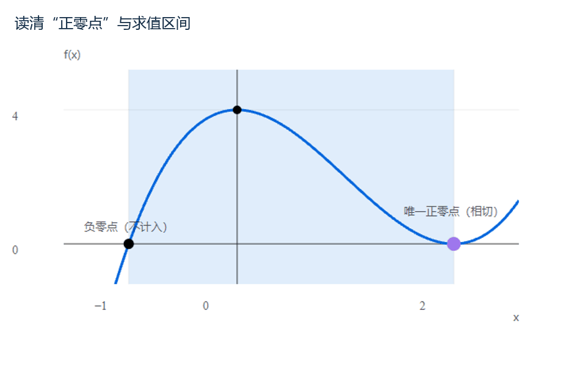

# 清启 · QingQi for Edu

面向学生的数学学习工作台：围绕一道题持续辅导，让学习路径、学情和下一组练习跟着实际作答变化。


## 四个功能，连接同一份学情

| 功能       | 学生能做什么                                           | 系统怎样处理                                                                   |
| ---------- | ------------------------------------------------------ | ------------------------------------------------------------------------------ |
| 个性化辅导 | 发文字、最多三张图片，或选择做过的题；继续讨论当前小问 | 维护原题、小问和教学方式，结合当前困难选择提示、追问、讲解或解答，流式显示回复 |
| 学习路径   | 在一张地图上选择有依据的路线                           | 区分真实先修和共现关系，结合学情、学习时间与题库供给规划路线；所选路线影响推题 |
| 学情看板   | 先读摘要，再看知识图谱，点节点了解依据                 | 初始估计、独立作答和辅助作答分开记录，不把聊天次数当掌握度                     |
| 个性化练习 | 每次练三道题，核对答案或取一条提示                     | 综合当前重点、复习、诊断与曝光，约束知识点和题型重复；新作答回流学情           |

“给我一点提示”只提供当前题的一条文字线索，不反问、不索要回复。“和导师一起做”才进入连续对话。提示不会被计为独立作答，也不会因为多点几次就声称学生已经掌握。

<details>
<summary>查看学习路径与三题练习</summary>


</details>

## 图示服务于解题

一次回复选择一张相关讲解图或一段教学动画。函数题可以观察零点、驻点和区间；几何题可以跟随构造与推理。坐标和计算优先保留分数、根式与精确表达式。

图上可用画笔、直线、曲线与标记，修改后作为图片返回同一对话继续讨论。播放会连续走到末尾，上一步和下一步用于分段查看。

下面是界面关键帧组成的演示：对同一函数比较正零点情形，确定参数，再检查指定区间的候选值。



演示截图使用项目自编数值题和合成示例学生；不包含真实学生历史。图片识读和开放式对话需要配置模型。精确数学工具有明确支持范围，图示与自由对话不会直接写成已核验成绩。

## 先运行演示

需要 Node.js 24、pnpm 10 和 Python 3.12+。从仓库根目录执行：

```sh
git clone https://github.com/271278430/QingQi_for_Edu.git
cd QingQi_for_Edu
npm install -g pnpm@10
pnpm install --ignore-scripts
python -m pip install -r education/service/requirements.txt
pnpm education:build
pnpm education:demo
```

打开 **http://127.0.0.1:18774/**。演示自带5个知识点和45道自编数值练习，无需密钥；使用独立的演示运行目录。退出服务按 Ctrl+C。

安装时跳过上游桌面资源准备，教育构建只沿现有 core、adapters、runtime 和 Web 的构建入口执行。Windows可用 `QINGQI_PYTHON` 指定Python路径；需要换端口时设置 `QINGQI_PORT`。

## 接入自己的模型与资料

进入 **设置管理 → 模型适配**，添加OpenAI兼容或Anthropic连接，在连接下配置具体型号与能力。文本和视觉可以分别选型，也可以共用一个支持图片的模型。对话框能切换已配置型号和推理档位；默认高档，可手动切低档。点击发送后冻结本轮配置，后续切换作用于下一轮。

密钥在本机加密保存，不回传浏览器。可选的8B/27B专项模型通过受控任务入口调用；未配置时不参与执行。

真实教材图谱、题库、画像和对话资料通过导入工具建立只读索引，原始文件保留在自己的机器。配置、数据库、学生历史和模型权重不随源码分发。导入与部署方法见[运行说明](education/docs/operations.md)。

## 架构与源码复用

一张系统关系图展示五层、16个模块。Agent Loop包含真正的回路：**决策 → 受控工具调用 → 观察/检查点 → 回到决策**；候选回复经过数学与教学核验，再由Store提交。

[查看系统关系图](education/docs/media/architecture.svg) · [模块职责与数据流](education/docs/architecture.md)

<details>
<summary>展开系统关系与 Agent Loop</summary>


</details>

直接复用ZCode的工具注册/执行、调度、PermissionService、MCP和Skill适配器、受控前台子任务、有界记忆筛选，以及模型设置、对话输入和共享UI组件。教育路由、教学策略、学习证据和SQLite状态由本项目适配，未将完整编码Agent原样搬进学生端。

| 目录                                  | 责任                                                |
| ------------------------------------- | --------------------------------------------------- |
| `education/service/src/qingqi`        | 教学循环、路由、模型协议、数学核验、学习服务和Store |
| `education/runtime/src`               | ZCode公共运行能力的适配边界                         |
| `education/client/src`                | HTTP/SSE契约和统一客户端                            |
| `education/web/src`                   | 四个学生页面、模型配置与设置管理                    |
| `education/tools`                     | 启动、导入、演示、回归与发布检查                    |
| `specs/education`、`education/docs`   | 行为规格与维护说明                                  |
| `apps/zcode-cli/packages`、`packages` | 保留的ZCode源码及依赖，按公开入口复用               |

Store是唯一可写状态所有者，负责会话、原题、小问、学习事件、配置、租约和幂等回执。Web只持有草稿和展示状态，教材与题库不由Agent改写。

## 验证与维护

当前发布执行了56组回归：四功能、原题连续性、图片/标注、流式协议、提示与答案边界、模型设置、工具权限、幂等、错误恢复、手机和架构图。多数模型边界使用可控服务验证，不能将这些结果解释为任意模型、任意题型都正确。真实模型接入、正式入口与数据保护独立检查，范围见[验收说明](education/docs/verification.md)。

```sh
pnpm typecheck
pnpm lint
pnpm architecture:check --changed
node education/tools/review_all.mjs
```

完整回归使用本机已导入的数学资料；只验证公共演示可运行 `python education/tools/demo_acceptance.py`。运行Python脚本需设置 `PYTHONPATH=education/service/src`，浏览器回归需 `QINGQI_PYTHON`、`QINGQI_NODE` 和Edge。生成报告保留在Git忽略的 `education/.local/reports`。

当前服务监听本机；对外部署的身份、TLS、备份与容量需要单独配置。维护时保留唯一状态入口，不在前端建立第二份成绩或任务队列。

## 来源与许可证

基于 [zai-org/ZCode](https://github.com/zai-org/ZCode) 适配。上游版本、来源和复用边界记录在 [education/source.json](education/source.json)。代码沿用 [Apache-2.0](LICENSE)，原有第三方声明和源码版权标注保留。
