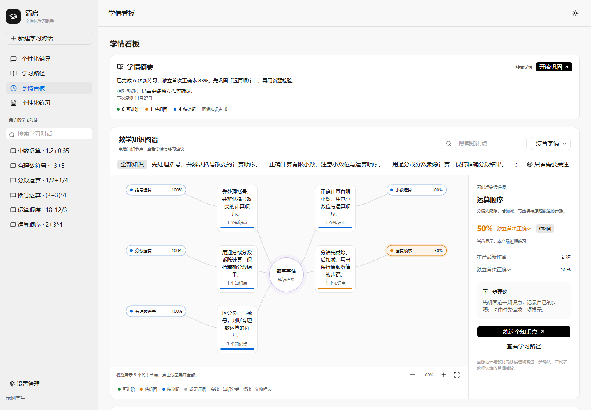
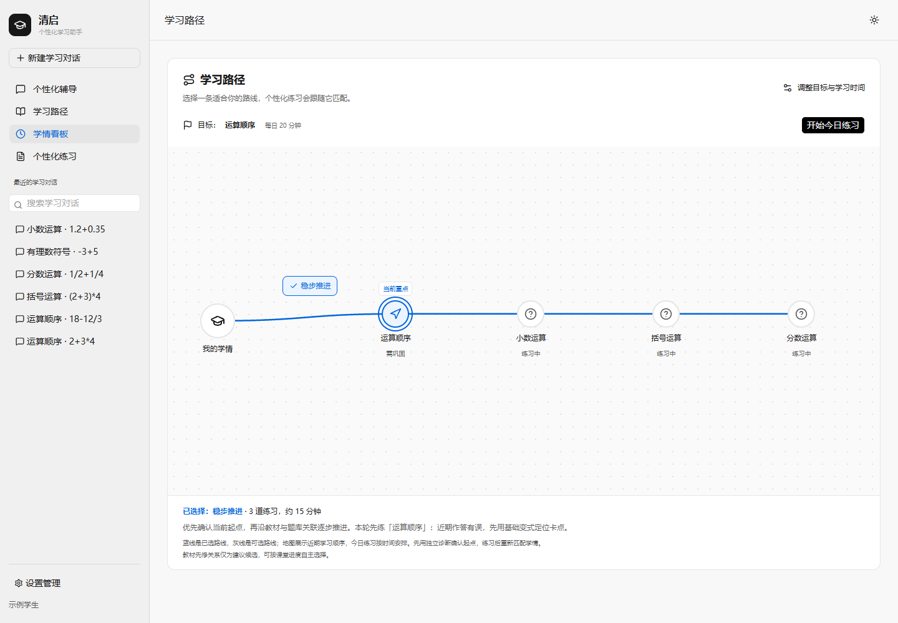
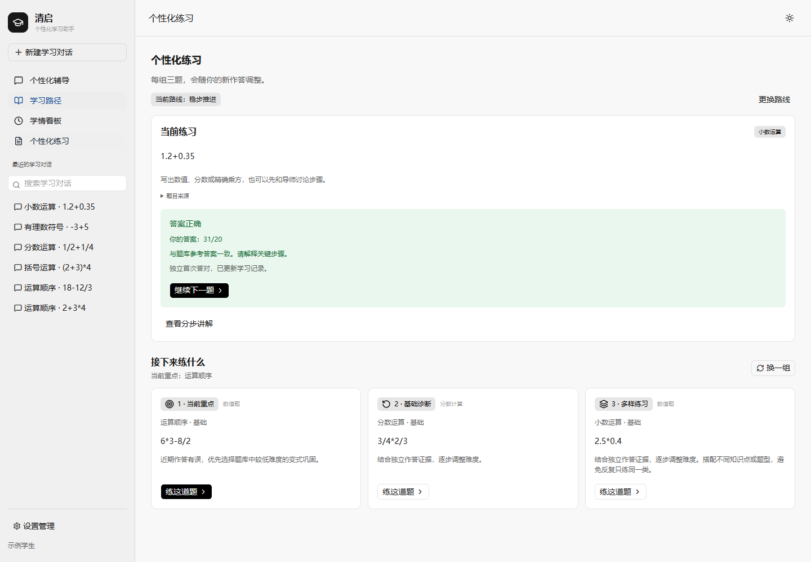

# 清启 · QingQi for Edu

清启是基于 [ZCode](https://github.com/zai-org/ZCode) 开发的学生端教育 Agent 项目，面向数学学习。它围绕一道题持续辅导，让学习路径、学情和下一组练习跟着实际作答变化。



## 四个功能，连接同一份学情

| 功能       | 学生能做什么                                           | 系统怎样处理                                                                   |
| ---------- | ------------------------------------------------------ | ------------------------------------------------------------------------------ |
| 个性化辅导 | 发文字、最多三张图片，或选择做过的题；继续讨论当前小问 | 维护原题、小问和教学方式，结合当前困难选择提示、追问、讲解或解答，流式显示回复 |
| 学习路径   | 在一张地图上选择有依据的路线                           | 区分真实先修和共现关系，结合学情、学习时间与题库供给规划路线；所选路线影响推题 |
| 学情看板   | 先读摘要，再看知识图谱，点节点了解依据                 | 初始估计、独立作答和辅助作答分开记录，不把聊天次数当掌握度                     |
| 个性化练习 | 每次练三道题，核对答案或取一条提示                     | 综合当前重点、复习、诊断与曝光，约束知识点和题型重复；新作答回流学情           |

“给我一点提示”只提供当前题的一条文字线索，不反问、不索要回复。“和导师一起做”才进入连续对话。提示不会被计为独立作答，也不会因为多点几次就声称学生已经掌握。

在对话里说“推荐一道类似题”，会直接得到真实题库题卡；未指定数量时推荐三道。系统先识别本轮任务，再引用原题：推荐不会自动变成旧题讲解，查看学情或路径也不会改写当前教学状态。题卡可进入练习，或在对话中指定“刚才推荐的第一题”继续讨论。

生成期间可以停止，刷新后也能停止仍在运行的消息。系统中断本轮连接与工具，保留输入和未完成文字；以新问题继续时不会自动重复发送上一轮模型请求。

<details>
<summary>查看学习路径与三题练习</summary>




</details>

## 图示服务于解题

一次回复选择一张相关讲解图或一段教学动画。函数题可以观察零点、驻点和区间；几何题可以跟随构造与推理。坐标和计算优先保留分数、根式与精确表达式。

继续请求“给我一个动画帮助理解”时，系统先读取当前题和已有教学图，再生成同源动画；相反数可以观察对称位置、等距和抵消关系，已有函数或面积图也能继续展示。已知构造通过本地工具完成，避免再次让模型猜图示。见[动画请求修复说明](education/docs/reviews/owned-animation-budget-v1.md)。

图上可用画笔、直线、曲线与标记，修改后作为图片返回同一对话继续讨论。播放会连续走到末尾，上一步和下一步用于分段查看。

下面是界面关键帧组成的演示：对同一函数比较正零点情形，确定参数，再检查指定区间的候选值。


演示截图使用项目自编数值题和合成示例学生；不包含真实学生历史。图片识读和开放式对话需要配置模型。精确数学工具有明确支持范围，图示与自由对话不会直接写成已核验成绩。

## 先运行演示

需要 Node.js 24、pnpm 10 和 Python 3.12+。从仓库根目录执行：

```sh
git clone https://github.com/271278430/QingQi_for_Edu.git
cd QingQi_for_Edu
npm install -g pnpm@10
pnpm install --ignore-scripts
python -m pip install -r education/service/requirements.txt
pnpm education:build
pnpm education:demo
```

打开 **http://127.0.0.1:18774/**。演示自带5个知识点和45道自编数值练习，无需密钥；使用独立的演示运行目录。退出服务按 Ctrl+C。

安装时跳过上游桌面资源准备，教育构建只沿现有 core、adapters、runtime 和 Web 的构建入口执行。Windows可用 `QINGQI_PYTHON` 指定Python路径；需要换端口时设置 `QINGQI_PORT`。

## 接入自己的模型与资料

进入 **设置管理 → 模型适配**，添加OpenAI兼容或Anthropic连接，在连接下配置具体型号与能力。文本和视觉可以分别选型，也可以共用一个支持图片的模型。对话框能切换已配置型号和推理档位；默认高档，可手动切低档。点击发送后冻结本轮配置，后续切换作用于下一轮。

密钥在本机加密保存，不回传浏览器。可选的8B/27B专项模型通过受控任务入口调用；未配置时不参与执行。

真实教材图谱、题库、画像和对话资料通过导入工具建立只读索引，原始文件保留在自己的机器。配置、数据库、学生历史和模型权重不随源码分发。导入与部署方法见[运行说明](education/docs/operations.md)。

## 基于 ZCode 的项目架构

一张系统关系图展示五层、16个模块。Agent Loop包含真正的回路：**决策 → 受控工具调用 → 观察/检查点 → 回到决策**；候选回复经过数学与教学核验，再由Store提交。

[查看系统关系图](education/docs/media/architecture.svg) · [模块职责与数据流](education/docs/architecture.md)

<details>
<summary>展开系统关系与 Agent Loop</summary>


</details>

项目以 ZCode 的运行模块、工具执行、权限、MCP、Skills、子任务、记忆筛选、模型配置与 UI 为基础。教育业务围绕学生问题展开：管理原题与当前小问，选择教学方式，核验数学结果，再把作答证据用于路径、看板和下一组三题。

通用任务控制同时对照 Codex 开源引擎的当前输入、工具分发、历史投影、停止和流式终态设计。本项目没有完整移植Codex引擎，采用范围、当前指令与坏历史处理见[本轮审查](education/docs/reviews/current-instruction-and-number-line-v1.md)及[通用能力审查](education/docs/reviews/codex-agent-capabilities-v1.md)。

## 按目录阅读项目

```text
education/                  学生产品
├── service/                Python 教学服务与状态
├── runtime/                基于 ZCode 的 Node 运行层
├── client/                 HTTP / SSE 通信契约
├── web/                    四项学生功能及设置页面
├── tools/                  启动、导入、维护与素材制作
├── tests/                  验收、浏览器场景、夹具与探针
├── server/                 可选专项模型服务
└── docs/                   架构、运行说明、截图与动画
apps/、packages/            ZCode 基础源码和工作区包
scripts/、.github/           工程检查、构建与 CI
docs/、specs/               基础工程文档与产品行为规格
third-party/                第三方资料、清单和许可证
```

每个版本化目录都有 README，说明目录用途、子目录和直接文件的职责。先读 [education/README.md](education/README.md)，再进入相应模块。ZCode 基础包保留原目录结构和版权；目录说明标明它们与学生产品的关系。

| 目录                                  | 责任                                                |
| ------------------------------------- | --------------------------------------------------- |
| `education/service/src/qingqi`        | 教学循环、路由、模型协议、数学核验、学习服务和Store |
| `education/runtime/src`               | 基于ZCode的工具、权限、MCP、Skills和记忆运行层      |
| `education/client/src`                | HTTP/SSE契约和统一客户端                            |
| `education/web/src`                   | 四个学生页面、模型配置与设置管理                    |
| `education/tools`                     | 启动、导入、演示、维护和资料制作                    |
| `education/tests`                     | 教学验收、浏览器场景、可控模型夹具和真实服务探针    |
| `specs/education`、`education/docs`   | 行为规格与维护说明                                  |
| `apps/zcode-cli/packages`、`packages` | ZCode基础源码、工作区包及其依赖                     |

Store是唯一可写状态所有者，负责会话、原题、小问、学习事件、配置、租约和幂等回执。Web只持有草稿和展示状态，教材与题库不由Agent改写。

## 验证与维护

2026-11-27发布检查执行了66组回归，全部通过：四功能、原题连续性、图片/标注、流式协议、停止、同题动画、提示与答案边界、模型设置、工具权限、幂等、错误恢复、手机和架构图。本轮还用实际会话的独立副本验证完整解答与重画同时交付。模型边界主要使用可控服务验证，范围见[验收说明](education/docs/verification.md)。

```sh
pnpm typecheck
pnpm lint
pnpm architecture:check --changed
node education/tools/review_all.mjs
python education/tools/directory_docs.py --check
```

完整回归使用本机已导入的数学资料；只验证公共演示可运行 `python education/tests/demo_acceptance.py`。运行Python脚本需设置 `PYTHONPATH=education/service/src`，浏览器回归需 `QINGQI_PYTHON`、`QINGQI_NODE` 和Edge。生成报告保留在Git忽略的 `education/.local/reports`。

当前服务监听本机；对外部署的身份、TLS、备份与容量需要单独配置。维护时保留唯一状态入口，不在前端建立第二份成绩或任务队列。

## 来源与许可证

本项目基于 [zai-org/ZCode](https://github.com/zai-org/ZCode) 开发。ZCode 的来源版本与模块边界记录在 [education/source.json](education/source.json) 和 [基础说明](education/docs/zcode-foundation.md)。代码沿用 [Apache-2.0](LICENSE)，保留原有第三方声明和源码版权标注。

<!-- qingqi-directory-index:start -->

## 目录与文件

清启是基于 [ZCode](https://github.com/zai-org/ZCode) 开发的学生端教育 Agent 项目。

清启教育 Agent 项目的工作区入口，连接学生产品、ZCode 基础源码、工程工具和项目文档。

### 子目录

| 目录                                  | 存放内容                                                                              |
| ------------------------------------- | ------------------------------------------------------------------------------------- |
| [.agents/](.agents/README.md)         | 项目开发规范、技能及其辅助资源。                                                      |
| [.github/](.github/README.md)         | GitHub 自动构建与仓库协作配置。                                                       |
| [.husky/](.husky/README.md)           | Git 操作的本地工程检查入口。                                                          |
| [.vscode/](.vscode/README.md)         | 编辑器工作区配置。                                                                    |
| [apps/](apps/README.md)               | ZCode 应用和开发文档入口；教育产品的运行模块依赖 apps/zcode-cli/packages 中的基础包。 |
| [config/](config/README.md)           | ZCode 基础工程的开发和运行配置模板。                                                  |
| [docs/](docs/README.md)               | ZCode 基础工程的设计、架构与维护资料；教育产品说明位于 education/docs。               |
| [education/](education/README.md)     | 学生端教育产品，包含个性化辅导、学习路径、学情看板、个性化练习及模型和系统设置。      |
| [packages/](packages/README.md)       | ZCode 的工作区基础包，包含 UI、协议、服务、客户端和平台实现。                         |
| [patches/](patches/README.md)         | 包管理器应用的依赖修补文件。                                                          |
| [public/](public/README.md)           | ZCode 基础界面的静态资源。                                                            |
| [scripts/](scripts/README.md)         | 工作区构建、架构、格式、发布和工程检查脚本。                                          |
| [specs/](specs/README.md)             | 版本化行为规格，包括 ZCode 的基础设计与 education 下的教学产品规则。                  |
| [third-party/](third-party/README.md) | 第三方源码、资源、清单和许可证；保留原版权和资产字节。                                |

### 文件

| 文件                                                                                      | 简要说明                                                                                                |
| ----------------------------------------------------------------------------------------- | ------------------------------------------------------------------------------------------------------- |
| [.architecture-baseline.json](.architecture-baseline.json)                                | .architecture-baseline 的数据或配置定义。                                                               |
| [.dockerignore](.dockerignore)                                                            | .dockerignore 模块的资源或工程文件。                                                                    |
| [.env.development](.env.development)                                                      | .env 模块的资源或工程文件。                                                                             |
| [.env.e2e.local.example](.env.e2e.local.example)                                          | .env.e2e.local 模块的资源或工程文件。                                                                   |
| [.env.example](.env.example)                                                              | .env 模块的资源或工程文件。                                                                             |
| [.env.production](.env.production)                                                        | .env 模块的资源或工程文件。                                                                             |
| [.gitattributes](.gitattributes)                                                          | 文件换行、二进制资产与 Git 属性规则。                                                                   |
| [.gitignore](.gitignore)                                                                  | 不进入 Git 的依赖、缓存、凭据和运行产物规则。                                                           |
| [.npmrc](.npmrc)                                                                          | pnpm/npm 安装源与工作区链接方式。                                                                       |
| [.nvmrc](.nvmrc)                                                                          | .nvmrc 模块的资源或工程文件。                                                                           |
| [.oxfmtrc.json](.oxfmtrc.json)                                                            | .oxfmtrc 的数据或配置定义。                                                                             |
| [.oxlintrc.json](.oxlintrc.json)                                                          | .oxlintrc 的数据或配置定义。                                                                            |
| [.prettierignore](.prettierignore)                                                        | .prettierignore 模块的资源或工程文件。                                                                  |
| [.release-it.mjs](.release-it.mjs)                                                        | .release-it 的实现文件。                                                                                |
| [AGENTS.md](AGENTS.md)                                                                    | 本目录的开发规范、模块边界与验证要求。                                                                  |
| [architecture-policy.yaml](architecture-policy.yaml)                                      | 模块所有者、层级、依赖方向与架构检查策略。                                                              |
| [CONTEXT.md](CONTEXT.md)                                                                  | ZCode 插件商店（Plugin Store）：说明文档。                                                              |
| [dependency-graph.mmd](dependency-graph.mmd)                                              | dependency-graph 模块的资源或工程文件。                                                                 |
| [DESIGN.md](DESIGN.md)                                                                    | ZCode Design System：说明文档。                                                                         |
| [Dockerfile.desktop-e2e](Dockerfile.desktop-e2e)                                          | Dockerfile 模块的资源或工程文件。                                                                       |
| [knip.json](knip.json)                                                                    | knip 的数据或配置定义。                                                                                 |
| [LICENSE](LICENSE)                                                                        | 代码许可原文。                                                                                          |
| [mise.toml](mise.toml)                                                                    | mise 的数据或配置定义。                                                                                 |
| [NOTICE](NOTICE)                                                                          | 来源与版权声明。                                                                                        |
| [NOTICE.md](NOTICE.md)                                                                    | 来源与版权声明。                                                                                        |
| [package-lock.json](package-lock.json)                                                    | ZCode 基础工程保留的 npm 依赖锁文件。                                                                   |
| [package.json](package.json)                                                              | zcode 的包信息、依赖和开发命令。                                                                        |
| [pnpm-lock.yaml](pnpm-lock.yaml)                                                          | pnpm 锁定的依赖版本和完整性信息。                                                                       |
| [pnpm-workspace.yaml](pnpm-workspace.yaml)                                                | 工作区包、平台依赖与构建许可配置。                                                                      |
| [README.en.md](README.en.md)                                                              | QingQi for Edu：说明文档。                                                                              |
| [README.md](README.md)                                                                    | 本目录用途、子目录与逐文件说明。                                                                        |
| [skills-lock.json](skills-lock.json)                                                      | skills-lock 的数据或配置定义。                                                                          |
| [THIRD-PARTY-NOTICES.md](THIRD-PARTY-NOTICES.md)                                          | 第三方依赖和资源的版权与许可声明。                                                                      |
| [tsconfig.base.json](tsconfig.base.json)                                                  | 工作区 TypeScript 公共编译配置。                                                                        |
| [UI_PLUGIN.en.md](UI_PLUGIN.en.md)                                                        | UI Plugin: Capabilities, Development, Debugging, and Examples：说明文档。                               |
| [UI_PLUGIN.md](UI_PLUGIN.md)                                                              | UI Plugin：能力、开发调试与示例：说明文档。                                                             |
| [vitest.config.ts](vitest.config.ts)                                                      | 测试固定注入事件上报端点，使遥测上报链路在单测中可验证；真实构建由 scripts/build-time-config.mjs 决定。 |
| [vitest.setup.ts](vitest.setup.ts)                                                        | Bugfix: Git Bash 会把 /usr/bin（GNU tar 1.35）注入 PATH 最前，子进程 spawn "tar"                        |
| [停止Flash教学.cmd](%E5%81%9C%E6%AD%A2Flash%E6%95%99%E5%AD%A6.cmd)                        | 停止Flash教学 模块的资源或工程文件。                                                                    |
| [停止教育工作台.cmd](%E5%81%9C%E6%AD%A2%E6%95%99%E8%82%B2%E5%B7%A5%E4%BD%9C%E5%8F%B0.cmd) | 停止教育工作台 模块的资源或工程文件。                                                                   |
| [打开Flash教学.cmd](%E6%89%93%E5%BC%80Flash%E6%95%99%E5%AD%A6.cmd)                        | 打开Flash教学 模块的资源或工程文件。                                                                    |
| [打开教育工作台.cmd](%E6%89%93%E5%BC%80%E6%95%99%E8%82%B2%E5%B7%A5%E4%BD%9C%E5%8F%B0.cmd) | 打开教育工作台 模块的资源或工程文件。                                                                   |

<!-- qingqi-directory-index:end -->
