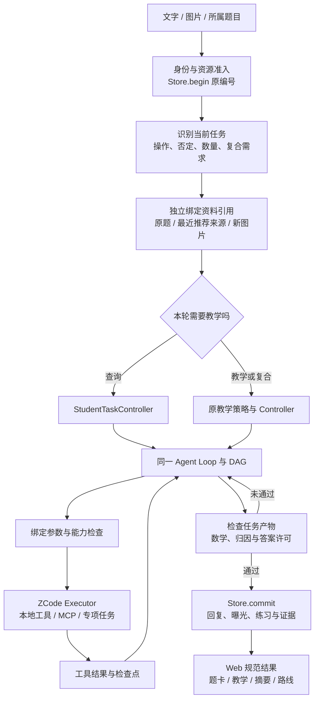

# 当前任务与工具执行审查 · 2026-11-26

截图中的请求是“给出推荐一个类似的题目”。正式记录的路由却是 `tutor`，`contextual_followup=true`，呈现偏好来自旧题的 `same_problem_preference`。系统没有推荐任务和候选题，最终沿旧题输出情景讲解。这是执行控制与任务结果校验的问题。

项目仍是基于 [ZCode](https://github.com/zai-org/ZCode) 开发的学生端教育 Agent。本次对照 [openai/codex](https://github.com/openai/codex) 的开源引擎，核对提交 `af71942309704997f4bdc86c020717646423c080`。以下链接固定到实际读取的源码。改动落在现有 Python 服务、ZCode Node 工具层与 Web 契约，没有把整个 Rust 引擎移入项目。

| 通用能力   | Codex 源码依据                                                                                                                                                                                    | 本项目的处理与改动                                                                                                                               |
| ---------- | ------------------------------------------------------------------------------------------------------------------------------------------------------------------------------------------------- | ------------------------------------------------------------------------------------------------------------------------------------------------ |
| 当前输入   | [RegularTask](https://github.com/openai/codex/blob/af71942309704997f4bdc86c020717646423c080/codex-rs/core/src/tasks/regular.rs) 接收 `Vec<TurnInput>`，启动当前轮次                               | 原始输入先形成 `task_plan`，原题单独形成 `source`。旧题不会将推荐、学情或路径查询改成教学。明确操作走规则；间接学习操作沿既有受约束分类器识别。  |
| 工具调用   | [ToolRouter](https://github.com/openai/codex/blob/af71942309704997f4bdc86c020717646423c080/codex-rs/core/src/tools/router.rs) 从响应项形成带编号的工具调用，并查注册能力                          | 三个学生工具进入原 Registry / Executor。参数必须与当前计划一致，Store 提供学生身份。推荐卡来自题库结果，不来自一句“已推荐”。                     |
| 决策循环   | [RegularTask.run_turns](https://github.com/openai/codex/blob/af71942309704997f4bdc86c020717646423c080/codex-rs/core/src/tasks/regular.rs) 组织输入与后续轮次，工具分发交付结果                    | 沿原 Loop 的编号、调用账本、观察和检查点执行。查询使用轻量 Controller；“检查/讲解＋推荐”遵从同一 DAG，必要工具执行前暂存候选回复，避免丢掉教学。 |
| 历史与投影 | [ContextManager history](https://github.com/openai/codex/blob/af71942309704997f4bdc86c020717646423c080/codex-rs/core/src/context_manager/history.rs) 区分保留历史、模型窗口、上下文事实与媒体投影 | 查询结果存入同一会话，教学历史跳过查询。查询不覆盖原题、模式、未完成步骤，也不续期临时状态。明确选择推荐题才建立新教学边界。                     |
| 权限与失败 | [ToolOrchestrator](https://github.com/openai/codex/blob/af71942309704997f4bdc86c020717646423c080/codex-rs/core/src/tools/orchestrator.rs) 将审批、沙箱与尝试纳入执行边界                          | 学生工具是固定只读能力，业务写入由 Store 原事务承担。工具失败保留失败状态；任务未完成时不能降级为旧题讲解。教育工具没有任意 Shell 能力。         |
| 流式交付   | [Responses SSE](https://github.com/openai/codex/blob/af71942309704997f4bdc86c020717646423c080/codex-rs/codex-api/src/sse/responses.rs) 处理增量与终态                                             | 继续沿现有 delta / reset / done 协议；已接受的 `student_tasks` 与历史采用同一投影。纯查询无需教学模型，结果就绪后直接交付题卡。                  |
| 子任务     | [spawn handler](https://github.com/openai/codex/blob/af71942309704997f4bdc86c020717646423c080/codex-rs/core/src/tools/handlers/multi_agents/spawn.rs)                                             | 现有 8B/27B 通过 ZCode 的受控专项任务入口运行。推荐是本地读取与排序，增加模型子任务对它没有收益。                                                |

## 实际执行顺序

`recommend_practice` 从完整、同年级题库选择，匹配知识标签、结构、学情难度与曝光；排除原题和相同题干。指定一道返回一道，默认或指定三道返回三道，上限三道。供给不足说明实际数量。候选不含答案或解析；接受回复只记曝光，点击“开始练习”进入真实练习页。自然引用“刚才推荐的第一题”则在当前会话绑定这道候选。

`preview_learning_path` 使用原学习快照与规划函数，输出预览而不修改已选路线；`read_learning_dashboard` 读取同一学生的实际学习摘要，可以按明确知识点过滤。显式提交历史做困难诊断继续沿原专项任务，避免将诊断误改成只读看板。

图片推荐只做一次必要识读，识读文本是资料。继续推荐使用已接受来源；明确“图里这道题”可以恢复真正上传的图片记录。查询中选择的新知识点也能作为下一轮推荐来源。资料不跨学生或会话。

## 补充发现与修复

- 复合请求执行推荐后丢失候选回复，返回问候语：候选回复共用一个暂存位，必要工具完成后消费。
- 选择推荐题后继承旧题故事：选择建立新教学边界，旧题教法和呈现偏好不参与新题初始化。
- 图片查询后引用“图里这道题”要求重新贴题：补齐指代并读取实际上传附件的记录，不构造空图片调用。
- “分析学情”携带实际记录误走只读摘要：区分查看已有学情与提交记录做诊断。
- “换一道新题”未结束旧任务：保留明确边界；推荐候选与选择候选是两个动作。
- 旧错误回复仍显示为正常教学：只读标记任务未完成、折叠原文；学生点击后以新编号执行，旧记录不改写。
- 并发读取下 Windows 曾以 EPERM 拒绝发布完整 Node bundle：沿 ZCode 原子文件发布设计对短暂共享冲突有限重试，继续保留旧完整入口；构建并发读取验收通过。

规格见 [current-task-tools-v1](../../../specs/education/current-task-tools-v1.md)，验收入口见 [verification](../verification.md)。可控端点回归验证控制流、协议和交互，真实模型正确率与教学效果需要另外评估。
