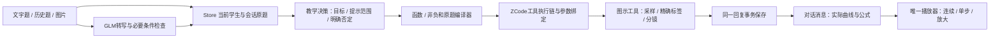

> 历史专项审查记录。当前架构与数量以[现行说明](../architecture.md)为准。

# 本轮教学图修复与验收

2026-11-23。已部署visual_teaching_v8，两个入口均返回200并实际打开四个学生模块。

## 根因与修改

1. 函数Controller此前依赖绘图关键词；静态提示还会把原题k、c、区间替换成相似例题。现在支持的函数题主动绘图，保留原题；提示的参数试探明确标注，完整解答第一屏展示实际函数曲线。
2. 零点情形小图和无关柱高不能清楚解释数学。现在使用一张可切换大曲线，注明轴、精确刻度、相切/负零点、最值区间和候选点；非负和使用对应根式/绝对值函数、定义域和零点，动态观察点确实沿批准曲线移动。
3. 提示曲线的数字刻度可能间接泄露未求参数。提示函数族使用说明清楚的x/r尺度，非负和使用内部一次式作横轴；完整解答才显示原变量与精确零点。静态和动画沿同一许可与原题绑定校验。
4. 真实GLM识图会把“题干完整但未截入选项”标成必要条件缺失。已修正识别指令，受控恢复只接受完整的支持函数数值目标和缺选项说明；符号模糊或真正缺条件仍澄清，既不猜题也不补选项。同会话已保存的这一误判也可恢复。
5. 单独Unicode负数被消息数学解析器当作普通文本，轴上显示了多余美元符号。轴刻度改用明确块级数学渲染，浏览器已核对负数与分数显示。

## 实际流程

未新建第二套会话记忆、绘图队列或播放器。数学事实由工具拥有，UI只读取合同。查看图示不写成绩；验收写入隔离库，生产历史与源题库保持原有数据。

## 已执行验收

- 29项数学/意图/正常HTTP入口：主动绘图、原题与提示边界、正零点、区间驻点、根式分数、负系数定义域、无图/静态要求、缺选项与模糊符号反例、重放与不写成绩。
- 12项浏览器交互：实际曲线、精确刻度、三种情形切换、导数联动、候选点、一次播放到末尾、放大同进度、刷新、手机/减少动态、静态双曲线。
- 35项原题续聊、23项组合呈现、30项故事/TTL、57项图示任务与图片归属回归；另外执行既有multimodal验收与9项架构源码绑定检查。
- 真实用户原图经GLM识别验收：0次修复、2次工具调用。
- 根pnpm typecheck、教育Web类型与构建通过；pnpm lint为0错误、538条存量警告；35个教育Web源码文件Hooks专项无诊断；架构门禁0违规。
- 两正式入口只读浏览器检查通过：四模块均能打开、练习各三题、无页面错误；HTML/健康接口/构建资源返回200。

GitHub freshness的git fetch仍因网络连接重置失败，未将联网基线检查称为通过。本轮验证的是当前本地代码与已启动服务。绘图编译器仍有明确题型范围，未声称任意数学题都能自动生成已核验动画。

## 使用

刷新页面后重新发送原题，新消息生成新版图示，历史消息保留原记录。

- http://127.0.0.1:18774/
- http://127.0.0.1:18772/

图像证据：curve-first-function-overview.png、reasoning-nonnegative-contradiction.png。
