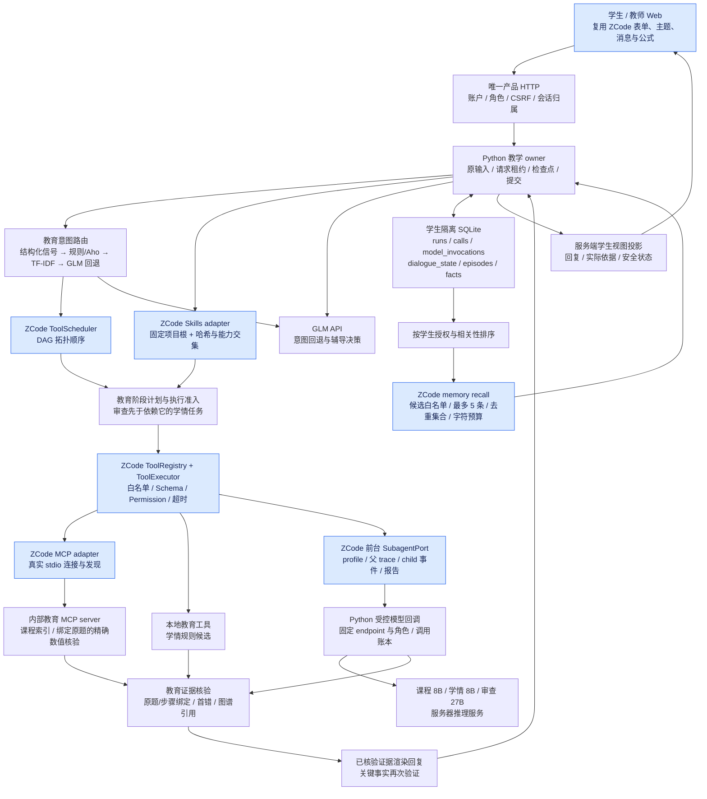
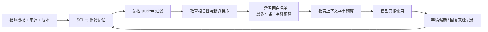

> 历史专项审查记录。当前架构与数量以[现行说明](../architecture.md)为准。

# ZCode 教育 Agent：实际复用、改造结果与后续模块

产品范围随后收敛为辅导、路径、看板、推题四项；当前页面与流程以[架构说明](../architecture.md)为准。本文件保留运行能力复用与此前架构审查记录。

2026-11-20，当前本地源码。教育产品仅使用 Web。现在是「教育业务 owner + ZCode 公共运行能力 + 专项推理服务」的模块化单体：可运行、可恢复、可审计的限定教育闭环。它尚未完成新版本真实模型评测与学校生产部署验收。

## 1. 当前实际架构

蓝色节点实际使用上游公共源码。教育意图类别、教学模式、输入绑定、数值判据、学生事实和持久化仍由教育领域实现。ZCode 本身没有 K12 意图分类器或学生掌握度模型。

专项任务已经有真实的上游 child/session/profile/trace 生命周期，执行回调仍调用既有 Python 模型客户端。没有迁入完整 ZCode AgentRuntime，也没有把一次专项调用包装成独立自治多轮推理。确定阶段由领域计划执行，GLM 不需要反复选择同一个已确定工具。

## 2. 上游设计与实际复用对应

ZCode 将交互端与会话运行时分开；工具通过统一契约注册、权限与执行器调用。Skills 提供按需能力说明，MCP 是外部工具适配层。子 Agent 由父任务创建有限 profile 与上下文，运行状态、事件和报告通过子任务接口回交。记忆召回是上下文构建的一部分，持久记忆抽取/合并是另一套受权限控制的后台流程。

| 模块     | 本轮实际接入                                                                               | 教育边界                                                              |
| -------- | ------------------------------------------------------------------------------------------ | --------------------------------------------------------------------- |
| 意图路由 | 保留结构化输入、Aho/规则、TF-IDF 与 GLM 回退；ZCode Scheduler 的真实顺序驱动阶段选择和准入 | TF-IDF 相似度不是校准概率，没有已训练双塔编码器                       |
| 子 Agent | createExploreSubagentPort / AgentProfile / 父 trace / child 事件与报告                     | 每个专项只允许对应 worker，前台一次受控调用，不复制主会话接受状态     |
| 工具     | createToolRegistry / createToolExecutor / PermissionService；模型可见契约取自上游 Registry | 固定 7 个教育工具；不注册通用 Shell、文件或 Coding 工具               |
| MCP      | createMcpAdapter 实际发现、连接与调用；比较输入/输出 Schema                                | 固定内部课程/数值 server；自建 Python MCP client 已删除               |
| Skills   | createNodeSkillAdapter 实际发现与加载项目 Skills                                           | 保留 manifest/hash/能力交集；学生、教材正文不能加载全局 Skills 或扩权 |
| 记忆     | @zcode/core/memory 公开并调用既有 recall 函数                                              | SQLite 是唯一可写来源，先学生隔离再召回；未接自动抽取/Dream           |
| Web      | Button/Input/Textarea/Select、主题、国际化、Tooltip、消息/Markdown/公式/代码/表格          | 同一 Web 组件与 HTTP 契约，领域页面只组合上游组件                     |
| 状态恢复 | 教育 Store 的输入指纹、会话租约、调用账本、部署签名与原子提交                              | 参考 ZCode owner/幂等原则；没有调用上游 CommandInbox 或 CLI 数据库    |

主要接入源码：

- [Node 运行 adapter](../../runtime/src/index.ts)、[记忆 adapter](../../runtime/src/memory.ts)、[公共协议](../../runtime/src/contract.ts)。
- [Python 桥接](../../service/src/qingqi/zcode_runtime.py)、[教学 owner](../../service/src/qingqi/agent.py)、[阶段计划](../../service/src/qingqi/planning.py)。
- [学生视图](../../service/src/qingqi/projection.py)、[Web 存储投影](../../service/src/qingqi/web_store.py)、[HTTP 错误契约](../../client/src/http.ts)。

上游源码对应：tool/registry.ts、tool/executor.ts、tool/scheduler.ts、subagent runner、adapters 的 mcp/skills、core memory/recall。没有复制这些实现；新增的 core/memory 导出只公开既有函数。运行包参考上游 Node/esbuild 打包边界，公共实现生成 bundle，未改变上游运行逻辑。上游许可与来源保留在根文件和 source.json。

## 3. 教育记忆怎样做

ZCode 的通用长记忆以文件清单、内容读取与按需召回进入上下文；已读/已召回集合避免重复注入，选择最多 5 项并控制读取预算。自动 extraction 提炼记忆，Dream 做后台整理。会话历史、上下文压缩与持久记忆职责不同。

教育场景可以复用召回和预算机制，但教师事实需要明确的授权写入契约。因此本项目使用以下三层：

| 层       | 内容与来源                                            | 写入规则                                                   |
| -------- | ----------------------------------------------------- | ---------------------------------------------------------- |
| 工作态   | 本会话当前原题、实际步骤、当前计划、观察和检查点      | 教学 owner 单路径保存，跨学生/跨会话不借用原题             |
| 学习历史 | 学生自述、实际作答、问题、Agent 回复，均带 provenance | 成功提交后记录；Agent 回复标记 agent_inference_not_mastery |
| 教师事实 | 教师确认的知识点、结论、来源、版本                    | 教师账户授权；模型和学情候选不能自动提升为事实             |

最多优先放入两项教师事实，然后放相关历史；其他授权事实仍可在预算内进入。过大完整条目跳过，不截断作答或教师事实。当前相关性是教育服务的简单文本匹配，不是 ZCode 的模型语义选择器或向量库。已接入的是过滤、预算和去重状态函数，未复刻整个通用记忆文件系统、自动抽取和 Dream。

下一阶段可以增加“学情候选 → 教师确认/纠正 → 版本事件 → 后续辅导使用”的闭环，再评估语义召回。不能直接让通用 Dream 把“可能不会”合并为“未掌握”。

## 4. 已改进和已去除

| 改造前问题                             | 当前行为                                                                  | 验收                                   |
| -------------------------------------- | ------------------------------------------------------------------------- | -------------------------------------- |
| 运行能力主要停留在外部插件与 UI 复用   | 主要教育路径直接调用上游 Registry/Executor/Skills/MCP/SubagentPort/recall | runtime-reuse-acceptance               |
| DAG 只保存顺序                         | 原生执行顺序驱动当前意图与工具准入；越序学情被拒绝                        | 复合任务实际工具顺序与负向准入         |
| 启发模式可从完整 observations 看到答案 | 即时与历史都由服务端白名单投影；不暴露 answer/context/child 报告          | 学生投影验收                           |
| 正确引用配虚构正文或泄答               | 已核验作答/课程结论使用证据渲染并再次验证                                 | 故意虚构/泄答的模型协议夹具            |
| 未知模型结果被重试                     | 发出前记录稳定 invocation_id；unknown/sending 阻止同编号重发              | 真正本机 HTTP 断连夹具，调用次数保持 1 |
| 明确繁忙变成普通工具错误               | model_busy 传递 429、recoverable、retry_after；可恢复原编号               | 专项 429 → 原编号成功                  |
| 不同 request_id 同时改同一学习会话     | SQLite 会话级在途租约准入，完成结果可重放                                 | 两个并发 HTTP 提交                     |
| 自然分项被视为改变原题                 | 支持当前原题 AST 的等值子表达式替换；无关等式仍拒绝                       | 3\*4=12 → 2+12=14                      |
| 代数/除零等边界产生内部失败            | 模型前识别不支持输入并澄清                                                | 无外部模型调用的边界场景               |
| 多条教育交互入口和两套旧 HTTP          | 唯一产品 HTTP，抽出 WebStore；迁移旧接口有效回归                          | 当前 HTTP/静态资源/隔离/恢复验收       |

已退役：教育 CLI、旧 token API、旧 HTML/Web server、/learn 教育插件、外部 product_mcp bridge、插件安装器及其验收脚本。保留上游 ZCode 源码、内部教育 MCP server、模型服务与后台账户/启动运维。用户全局插件配置未修改。

## 5. 成熟模块还需要补齐什么

| 模块       | 已完成                                                | 下一步                                                                            |
| ---------- | ----------------------------------------------------- | --------------------------------------------------------------------------------- |
| 教学入口   | 响应式 Web、学生/教师角色、真实证据展示与安全错误呈现 | 教师审阅、候选确认/纠正、班级和课程管理的完整业务流程                             |
| 任务 owner | 会话级租约、输入指纹、模型/工具账本、检查点与幂等恢复 | 目前繁忙拒绝而非持久 FIFO 队列；缺 revision 冲突处理、真实在途取消与故障运营处置  |
| 路由与编排 | 明确信号、领域意图、受控 DAG、GLM 回退与专项任务      | 建立真实教育路由集、混合意图与澄清评测、版本化路由策略；按证据决定是否引入编码器  |
| 工具扩展   | 本地/MCP/Skills 的固定契约、权限、输入绑定和预算      | 教师配置与扩展审批、工具健康与版本发布流程；继续保持白名单                        |
| 核验与生成 | 精确数值等式、图谱引用、关键事实证据回复              | 代数、单位、应用题、几何及其他学科需各自判据与 rubric；自由对话仍需语义忠实度评测 |
| 记忆       | 学生隔离、来源、事实版本、有限召回                    | 语义检索、教师纠正/撤销、保留/删除规则、学情演进评测；不能用模型推测替代事实      |
| 模型网关   | 固定角色/endpoint、Schema、用量记录、未知结果防重发   | 新版本真实 API/8B/27B 验收、provider 幂等能力、限流容量、token/费用预算与监控     |
| 可观测性   | run/trace、工具和 child 事件、持久账本                | 当前 UI 主要展示完成/恢复投影，缺实时 SSE、延迟与费用聚合、告警与故障诊断工作台   |
| 部署治理   | 本机账户、loopback、SSH 隧道、版本/预算恢复签名       | 学校 SSO、TLS、生产 HTTP server、持久登录、备份恢复、并发压力测试与数据治理       |

建议保持模块化单体，单一教育状态 owner。GPU 推理因资源和生命周期独立部署；其他模块先通过稳定契约拆清楚，无需提前变成大量微服务。

近期优先顺序：先同步并复验新版本真实模型/远端核验服务；再做教师确认与纠正闭环、实时状态与可靠取消、模型费用/容量监控；随后逐学科扩展判据与教育路由评测。多加几个子 Agent 不能代替这些模块。

## 6. 本轮验证与实际限制

- 原生运行能力协议验收：21 项通过；实际 ZCode runtime、MCP、Skills、工具与 child 生命周期，本机模型 HTTP 夹具，remoteInference=false。
- Web 产品 HTTP：14 项通过；真实账户/CSRF/隔离/持久化/恢复，离线教学，不含已退役外部插件。
- 浏览器复用与故障呈现：7 项通过；公式、代码、表格、主题、语言、键盘、窄屏和 unknown 刷新后禁用重发。错误呈现夹具不代表推理。
- 浏览器持久恢复：2 项通过；真实 HTTP 与已完成工具账本，原输入/编号不变。
- 提供方协议：4 项通过；JSON mode、辅导动作、短引用映射。
- 上游相关核心测试：4 文件、134 项通过；memory recall、scheduler、subagent explore、executor trace。
- 根类型与 CLI 类型检查通过；CLI 检查 34 项任务完成。根 Lint 0 errors / 538 warnings，CLI 0 errors / 86 warnings，均有上游存量告警；教育专项和 Hooks 结果见最终验证清单。
- 最终 Python 回归 72/72 通过（约 104 秒）；教育源码 Lint/Hooks 均为 0 warnings / 0 errors，新增运行源码格式专项通过。全仓格式检查扫描 9727 个文件，1573 个文件仍有格式问题；未全仓重排原有文件。
- 当时的格式与本机运行报告仅在本地归档；当前验收方法见[verification.md](../verification.md)。

此前回归暴露了提示文案问题与逐轮加载上游依赖的冷启动超时，均已修复。运行入口改为 ESM bundle，保持 25 秒预算；最终单次整轮 Python 回归为 72/72 通过，完整记录保留在报告中。

未调用本轮真实 GLM/8B/27B，不将旧 9/12、旧延迟/token 或简历指标作为新产品分数。最初逐轮 TS 源码加载的单次离线探针约 5.14 秒；改为公共源码 ESM bundle 后，单次离线问候约 0.83 秒，实际数值审查约 1.36 秒。仅是本机开发探针，不能代表真实模型 p50、吞吐或学习质量；未完成负载评测。上游共享 Web 资源仍有大包告警，需要按真实加载与运行数据继续优化。

远端正在运行的模型适配器尚未同步本轮 qingqi.domain_tools；正确自然分项必须在同步后重新评测。离线工作台已重启加载新版本，健康端点 runtime=zcode_education_capabilities_v1；旧真实模型工作台、训练与远端权重未重启或修改。当前状态是工程闭环加强，教学有效性与生产成熟度仍待验收。
