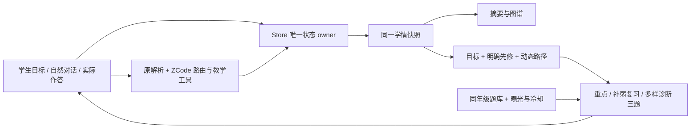

# 学情驱动的路径、三题推荐与自然对话

当前诊断窗口、错误后重新确认和递进复测规则以 learning-evidence.md 为准；原统一三天间隔已由 1/3/7/14/30 天的事件驱动计划替代。累计历史计数保留，当前判断使用最近 30 天最多五次独立首次作答。

产品仍仅四项学生功能。看板先显示学情摘要和图谱；辅导页面只保留消息历史、自然语言输入与发送，不要求填写算式、知识点、步骤、学习记录或选择辅导模式。原题/步骤由已有 normalize、同会话绑定和路由解析，学生可以直接说“给我提示”“核对答案”“还是不会”。恢复仍重放 original_input 与原编号；简单界面不能取消核验、权限或答案保护。

同题短数值/等式作答沿用最近明确的追问/启发式提示偏好，先核对当前作答；不能仅因为已经提示两次就直接给整题答案。明确表示仍不理解或请求讲解时按原反馈规则升级帮助，不把偏好绑定到其他会话或其他题目。

学情状态由 Store 保存的真实作答与来源标注画像派生，历史画像不等于当前掌握。规划优先遵守明确编写的先修依赖；导入图谱未经确认的候选关系仅供建议，不作为强制阻断。先修节点有一次新的独立正确作答且最近表现正常时，可以快速确认起点并诊断目标，不能据此标为稳定掌握；稳定仍要求多道不同题、难度变化与独立证据。错误或提示后完成安排基础变式，稳定但到期的节点安排复习。路径说明为什么先练、何时推进、每日分钟预算，保存目标后与每次新作答后重算。

每组推荐目标为三道：一道本轮重点/目标推进，一道薄弱补强或到期复习，一道相关诊断/跨知识域练习。候选只来自同年级可核验题，保留历史已做题排除、未完成当前题排除和错题一天/正确题三天的原题冷却；不足三道明确说明，不能突破核验或年级边界凑数。有至少三个可用知识点时三题使用不同知识点，并按同一组的知识域、题型、题目模板与知识点重叠惩罚重复；全池只有一两类时按实际供给降级并说明。每题给出学情依据、目的与难度理由，不能只随机抽题。新错题/辅助作答降低后续难度，新的独立正确证据允许渐进提升。

GET /api/learning 只读，刷新不增加成绩或曝光事件。新 POST /api/practice/recommendations 接收 request_id，由 Store 单一事务 owner 更新本学生曝光与批次记录，生成新三题并持久化返回结果；相同编号幂等返回原批次。浏览器“换一组”复用现有执行/未知结果重放机制。目标、题库版本或真实练习证据改变后旧批次失效并派生新的组合；换组仅记录推荐曝光，不计为作答或掌握。历史批次用于降低最近重复题、题型和知识点的概率，不无限困在同一候选子集。

所有接口投影不含标准答案和源学生身份。练习开始、作答、提示、辅导继续使用现有命令和同一事件 owner。UI 不持有另一份 accepted 队列、学习档案或推题缓存。

真实教材路径展示当前目标及最多两个补强/复习/诊断建议；未经确认的先修候选可以作为建议，但不标为先修阻断。当前目标稳定后优先继续同知识域的薄弱或待诊断节点，避免长期停在已稳定的目标。摘要优先说明规划的当前重点，保持推荐与路径一致。历史日期只用于提出复习确认建议，不写成新测掌握；批次学情指纹包含日期，跨日重算到期复习和冷却供给，普通同日刷新保持批次稳定。

路径的当前重点与推荐使用同一可用题池，排除历史已做、当前题和冷却题；目标暂时没有新题时，明确保留目标并说明原因，选择同域可用补强节点，避免路径声称练目标但实际推荐另一个知识点。已完成的题到期仍可作复习，不通过换组绕过冷却。

质量准入同时检查题干完整性：图1/图2、图中、下表等缺少已挂载图片/表格上下文的题退出新推荐和新练习准入，不能因为有数值答案就当成可用题。旧练习保留回放与历史核对数据，不删除作答。此检查补充旧导入索引的漏检，原源文件与原索引不重写；后续重新导入使用同一缺图/缺表规则。

验收以隔离的真实 HTTP/SQLite 与浏览器流程为主：三题分工/多知识点/可供题型多样性，同题冷却与同年级，换组不计分且编号幂等，错后基础补强、独立正确后路径推进、导入先修候选不阻断、预算约束，摘要随新作答更新，简单对话能核验并保持当前题与重放语义，移动端与浅深色可用。现有教学与隔离回归、类型、Lint/Hooks、构建和架构检查。

