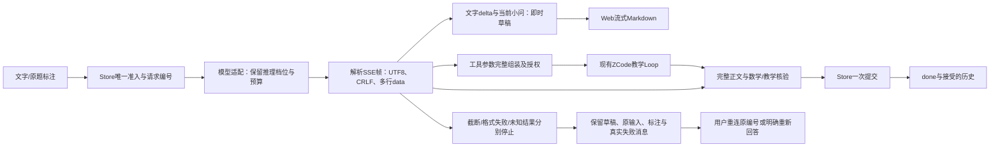

# 对照Codex的真实流式教学与失败恢复

2026-11-25，正式run31中GLM-5.3-Flash完成4096个推理token后以length结束，正文为0，耗时89.5秒；run30首段正文83.4秒。已确认ModelSettings.model漏传部署reasoning_effort=low。不能把推理流冒充正文，也不能关闭GLM-5.3不支持关闭的思考模式。

参考openai/codex提交c265acf3b138a12629b6f344bd08ee1f2c28c934的codex-rs/codex-api/src/sse/responses.rs和responses_error.rs：output_text.delta即时转换为类型化文字事件，completed/incomplete/failed独立处理；工具参数先完整组装，错误按终止原因分类。这里适配OpenAI Chat Completions/Anthropic及现有ZCode运行时，不声称使用未公开的Codex桌面界面源码。

模型适配层保留已配置的reasoning_effort；官方GLM-5.3未配置时采用受支持low，显式high/max不被覆盖，其他供应商不注入GLM选项。预算和模型选择不修改用户保存配置。

文字增量不等待整句或公式闭合。草稿校验只检查当前已出现的禁止输出/错误归因，完整回复仍需最终教学和数学校验；“必须解释概念”等完整性要求不能拦截未写完的片段。推理内容仅触发通用进度，不展示推理文本。工具参数不通过文字delta展示或在完成前执行。Web向原ZCode MessageResponse传streaming状态，支持未闭合Markdown和公式。

已明确length结束的自然文字为model_truncated，保留提供方用量和当前流式草稿，不写成完成回复。JSON/工具参数截断仍为协议失败，不执行半份参数；网络中断结果未知禁止静默重发。错误后读取Store的同会话快照，不能把上一轮已接受的回答当成本次回复。明确“重新回答”才用新request_id，仍携带原题、图片和visual_context；展示链路断开可以沿原编号恢复已接受结果。事件序号和request_id持续校验，切换会话后旧流不可覆盖新会话。

真实文字delta在失败checkpoint中保存为partial_text，Web只读投影partial_response并明确标注“回复未完成”。response仍为null，不更新掌握、成绩或已接受导师记忆；刷新可查看该未完成片段。仅有小问标题、进度或推理而没有正文delta时不伪造partial_response。

已有标注失败记录若最后的提供方元数据明确为length且没有工具调用，旧model_protocol在只读显示中升级为model_truncated，提供保留原输入的明确重新回答入口。旧调用账本、失败事件和请求编号不改，也不自动重发旧请求。

原图中的已知点名和连线拓扑随标注来源一起传入视觉教师，区别已有教师图与学生新增颜色笔迹。短问题“连上这根线是否有帮助”必须先辨认新增线的端点，不能用历史中的CD替代图片中新增的EF；不清楚端点时说明不确定。只讨论本问的帮助，不把新增标注当作已验证结论。

流式正文已满足数学和教学限制时，不因轻微长度超目标再次发起整轮润色并清空已显示文字；保留长度质量标记，长小数继续通过显示格式化处理。明确禁止答案、错误归因、条件/数学错误和过多追问仍执行原核验及有界修复。来源记录中已核验的本问角度可作教师背景，但不能把其他问的结果或未核验的直角补入本问。

验收包括：无标点首段真实增量、未闭合公式、UTF8跨块、CRLF与多行data、工具参数组装、推理不泄露、EOF/坏帧/截断分类、默认视觉low从设置到实际HTTP请求、显式高档位及其他供应商不变、失败草稿保留及Store快照、重新回答的新编号和原题标注引用。真实失败原输入和图片只读复制到隔离root验证；正式历史不用于写入验收。
