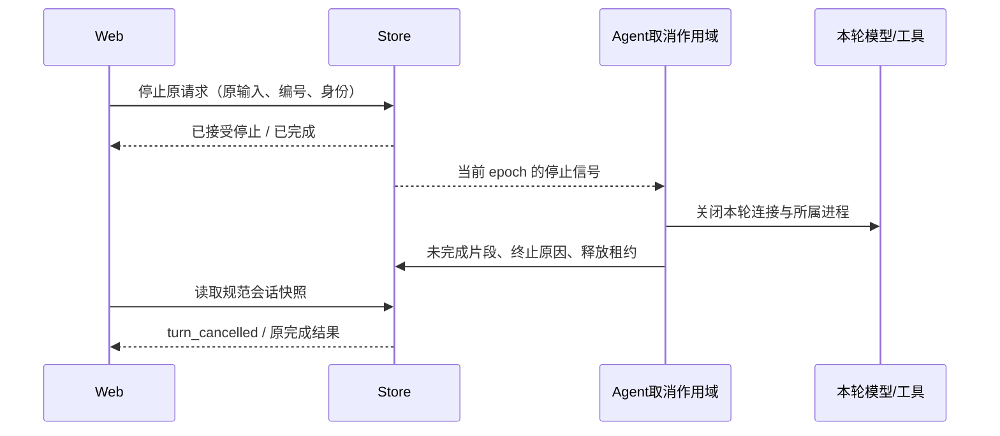

# 轮次停止与有界执行

对照 Codex RegularTask 的 CancellationToken、轮次终态与工具执行边界，为现有教育 Agent 增加主动停止。Store 仍是唯一接受状态所有者，保留原题、历史和学情；停止不是清空会话。

POST /api/teach/stop 携带原 session 与完整原 request，沿既有身份、Origin、CSRF 和资源归属检查。停止命令按学生、会话、原请求编号、原输入指纹和 history epoch 幂等保存。模型选择不重新解析，不会因点击停止调用模型。可在原请求准入前接受停止；不同输入不能共用编号。已接受回复返回 completed，不撤销完成结果。停止与回复提交共用 Store 事务边界，先接受的事件决定终态。

教学和停止均先解析请求，再沿同一 WebStore 准入验证全部图片及同会话已接受图示，之后才创建运行或停止记录。非法资源不会污染可读会话。准入得到的 history epoch 仅由服务端传入停止事务，历史变更后不得写回旧停止命令。用户主动停止不列为系统错误。

Agent 每轮创建临时取消作用域，监听 Store 停止命令；它不是第二份接受状态。停止关闭本轮拥有的 HTTP 连接及 Node/MCP/子任务进程，决策、工具和最终提交边界检查同一信号。外部模型请求可能已经受理，停止后不得静默重发。调用账本保留结果未知状态，轮次以 turn_cancelled 结束；partial_response 是未接受片段，不计成绩、掌握或教师事实。原输入和图片仍可编辑，以新编号发起新问题。

已显示的本题教学片段是帮助曝光；后续学生提交答案时按辅助作答处理，不能通过停止生成伪装为独立完成。未显示正文的停止不降低独立性。图上标注的帮助以原图所属 assignment 绑定，不能串到另一题。

Web 生成中提供停止按钮；刷新后可从正在运行的历史消息发起停止。按钮使用同一 EducationService；只在读取服务端终态后解锁，不把取消 fetch 当作后端已停止。迟到的停止或流回包受 generation、session selection 和当前请求引用保护。同步的在途引用防止同一帧双击创建两个请求。

Runtime RPC 使用整个操作的绝对 deadline，并与整轮预算取最小值；回调或其他帧不能续期。相同回调编号不能执行两次，工具参数与能力仍由原 Schema / Registry 绑定。关闭运行时是独立的有界清理，不延长推理预算。清理历史同时失效旧停止命令。

验收采用真实 HTTP 与受控模型：正文后停止、首字前停止、JSON 与 OpenAI/Anthropic 流、准入前停止、同编号重放、已完成竞争、输入冲突、跨学生/会话、图片保留、停止后新请求、刷新后停止、双击发送、桌面与手机。RPC 回调与总 deadline 验收不依赖真实模型。执行全量产品、Web 交互、类型、Lint、Hooks、架构与构建检查；正式学生数据只做保护核对。
