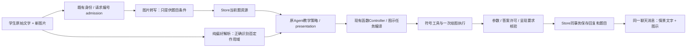

# 多种教学呈现与否定作用域

2026-11-23。实际请求“分别给出动画和情景教学”携带新函数题图片，图示执行前连续三次被拒绝：visual.forbid_animation=true。根因是动画及故事解析的裸“别”匹配“分别”内部字符，后续函数Controller又未遵循该否定策略。

## 所有者与输入

当前学生原始请求是教学要求唯一来源。题干/OCR提供数学条件，历史提供同题已接受偏好，二者不能覆盖本轮明确要求。纯请求偏好解析器统一处理动画、故事及追问的否定作用域；单独“别”必须是命令或带“请/先/你”等命令上下文，不能匹配“分别/特别/区别”等词的内部字符。现有Store仍拥有资源与接受的偏好，既有Agent admission/lease/请求编号仍拥有执行与重放。

函数Controller根据同一teaching_plan选择动画、静态函数图或纯文字，不再仅根据有无“动画”字样绘图。授权参数由原符号工具核验，同一调用只执行一次。学生请求“分别”时，回复包含清楚标注的情景解释和实际动画；故事以函数曲线作为高度路线解释相切、正零点和区间比较，不添加参数或物理条件。提示时附相似例子且明确标注；答案授权后才展示原题解答。明确拒绝动画但要图时用同一批准数据的静态投影，明确纯文字时不调用绘图工具。

非负和故事必须把非负表达式作为角色，例如sqrt(a-3)与abs(b+2)，不能把变量a/b自身断言为非负。只在完整两项非负式相加为0的支持结构上编译，公式与显示均来自原题；相似数值动画不冒充实际变量。未知题型仍由现有导师处理。

## 验收

先通过隔离HTTP复现原截图新图请求，覆盖分别/特别/区别、真正否定、否定和正向组合、图片中的说明不污染偏好、新图片切换原题、静态/动画/文字、非负表达式与变量区分、幂/答案限制、重放不重复OCR或工具、失败保留草稿。浏览器覆盖附件随消息、原题栏切换、两张函数图及情景文字、播放/单步/刷新。运行既有故事、函数续聊、图示回归和必要工程门禁。验收不写生产历史，不改源教材题库，不自动重发旧的失败模型调用。
