# 上下文教学模式与有效的图像/动画配对

视觉配对规则已由[single-teaching-visual-v1.md](single-teaching-visual-v1.md)替代，默认一次教学只输出一个图或动画。以下保留本轮早期规格及教学模式规则的来源。

2026-11-25用户明确修正：教学模式按当前对话及学情判断；默认分别提供一张有教学价值的图片与一段动画。替代此前“无其他声明一律苏格拉底”和几何默认仅静态图策略。

Store的原dialogue_state拥有teaching_mode（mode、来源、理由、小问与source_run_id）。Agent只在本轮准入后读取它，choose产生本轮决策，规范回复提交时同事务保存。当前明确要求优先；概念/为什么优先解释，提示优先启发，主动推理可用苏格拉底，连续不懂切换为当前步骤讲解；同题短续问恢复模式。新题、取消与另一小问重新评估。答案许可依旧按当前小问核验，不能因恢复answer字段把其他小问答案泄露。模式、内容组织、图片/动画形式、模型/推理档位相互独立。

```mermaid
flowchart LR
 input[输入/附件/当前小问] --> owner[Store读取同题教学模式与真实学情]
 owner --> policy[当前意图优先 → 困惑/作答 → 同题延续 → 新任务策略]
 policy --> plan[本轮教法/长度/答案许可/可视化目标]
 plan --> loop[原Agent Loop与ZCode工具链]
 loop --> pair[同一原题/同一步：静态讲解图 + 有因果变化的步骤动画]
 pair --> check[检查条件/单位/作用/真实类型/当前问/答案许可]
 check --> commit[Store同事务：回复/图示/教学模式]
 commit --> web[对话内分别显示图和动画，播放/单步/标注复用原组件]
```

默认配对最多两个产物，属于本轮当前教学小问。静态图强调题目结构、关键条件或当前辅助线；动画显示可观察的变换、推导顺序、函数变化或数量关系，并提供逐步依据。几何只使用符号核验后的构造，函数只使用原题编译结果；不能复制静态截图冒充动画，不能任意改条件或用换参数后的答案图替代当前未授权提示。多问回答中图/动画明确绑定本轮正在展示的小问；新问重建配对，不混用中点与非中点构造。

现有render_teaching_visual保持唯一入口。受控配对编译器把现有可信图示/动画转换成同题的互补产物，生成后再走原schema与原题绑定校验；不增加第二套图片历史或播放器。reasoning_diagram只接受原function_reasoning/nonnegative_reasoning/identity_probe编译器参数，静态展示同一份关键曲线/条件/代入关系，含无进度播放器的推理图；参数和披露仍需核验。模型上下文只取可视化的结构摘要，不重复传全部采样/帧。多幅曲线标注快照需完整合成，不能只截一幅。一般概念优先使用已有数轴、根式、分数、面积或曲线模板；模型可通过原工具选择相互对应的图像和动画。没有足够条件或缺少可信模板时明确说明并先澄清，不能贴无关图片或宣称动画已完成。用户明确只要文字/静态/动画时按当前要求改变呈现，不覆盖教学模式。

正文提到“已生成动画/动画用来展示”必须存在真正的animation_scene。只有静态图时用“静态图”，仅文字时不声称已经绘制。旧已接受消息只做安全展示修正，保持原记录与幂等结果，不把旧图静默伪造成新动画。标题只标一次当前小问。同一小问已公开的答案可以作为后续解释的上下文；披露来自Store.answer_parts而非教学模式字段，禁止扩到另一问，当前“不提供答案”仍优先。

验收通过实际HTTP与浏览器复现截图：第一问默认一图一动画；构造必须D为中点；动画播放时坐标或步骤真实变化，连续播放到结尾；第二问图不能用中点构造；静态/纯文字显式选择不虚称动画；模式在刷新/短续问恢复，连续困惑升级讲解，换题/换问不继承答案许可；精确坐标、标注回传、流式、高低档与四功能仍通过相应回归。真实模型和正式入口另验，不写正式学生成绩。

静态推理图只投影图片实际需要的曲线、条件和关系，曲线最多61个采样点；保留精确刻度与关键点，不复制完整动画故事板。两份产物仍须满足原64KB工具返回限制。单独请求静态推理图时，也要恢复对应规范动画参数并执行原题/披露校验，不能依赖同行动画才安全。已有恒等式可信编译器也参与默认配对；自动图示不替代当前作答核对或当前困惑的解释。学生明确要求继续提示时保留启发式模式并增加支撑，不强制改成完整讲解。

明确要求连接点时，配对使用已经批准的完整点线图和同组点线的逐线绘制动画，不能让默认旋转动画覆盖连接命令。由可信几何图投影的绘制动画仍逐项核对原始点、线、图形与对应小问。
