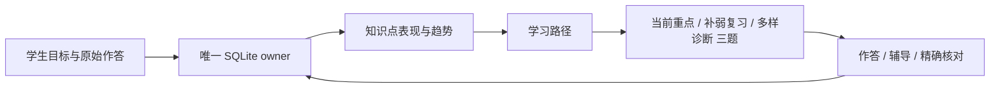

# 四项教育功能收敛

2026-11-20。产品仅展示个性化辅导、学习路径、学情看板、个性化练习。课程图谱、ZCode 子任务/MCP/Skills/工具与记忆作为后台支撑；不展示模型连接、工具轨迹、技术记忆、独立教师管理或知识库页面。

## 状态与接口

Python 教育服务及其 SQLite Store 唯一拥有学生目标、练习分配、提示事件与作答结果。Web 只保存草稿及服务投影。所有学习接口复用账户、Origin、CSRF 与学生隔离。

- GET /api/learning：目标、知识点表现、近七日趋势、路径、推荐题与当前练习的安全投影。
- POST /api/learning/goal：选择内置知识点目标及每日 10–45 分钟预算。
- POST /api/practice/start：固定题库 item_id 与 request_id，原子创建练习及专用辅导会话；重复编号重放，变更参数拒绝。
- POST /api/practice/answer：assignment_id、request_id、数值答案。原题及标准答案从服务端题库取得；精确有理数比较。重复编号不增加次数；冲突拒绝。
- POST /api/practice/hint：assignment_id、request_id、style=socratic/heuristic/explain。苏格拉底反问与分层提示分开，显式讲解可给解法；提示与失败后的重做不计独立首次答对。

练习反馈保存后，路径与推题使用同一事件数据实时派生，不保存第二份掌握度真相。已完成辅导会话对题目的帮助也计入辅助标记。错误反馈只给提示；显式请求讲解才展示解法。未提交的推荐题和练习投影不包含标准答案。

## 四项功能

1. 个性化辅导继续复用实际作答核验与多轮自动策略；界面只保留自然消息和发送，学生通过对话请求提示、追问、讲解或核对。启发式提示在公开请求中为 heuristic，在执行工具中映射到原 socratic 契约，并用领域提示生成器区分表达；不放松启发模式的泄答约束。自然对话、动态路径和三题组合的当前规则见 [adaptive-learning.md](adaptive-learning.md)。
   当前同会话原题的追问态可接受简短数值答案或单步等式，将它绑定到已核验原题并保存输入来源；过期、换题、跨会话不绑定。分项正确仅确认该步并保留追问态。练习专用会话中已提交且核验通过的完整数值作答，原子写入同一练习事件；辅导、聊天正文和部分正确步骤不算完成。
2. 学习路径使用带版本的内置数学知识点与明确先修顺序、学生目标和每日时间。图谱同名候选不当成确认先修。无作答数据时先诊断，不能声称已个性化掌握模型。
3. 学情看板显示实际独立首次作答、正确率、需巩固知识点、辅助练习和七日趋势。少量证据标记待诊断；最多描述近期练习表现，不认定长期掌握。
4. 推题按目标路径、近期错误、辅助情况、题目难度、已做题与复习间隔排序。每题显示推荐理由；不会因浏览、聊天或重复同一题抬高能力。冷启动先给诊断题。

初始覆盖数学数值题：运算顺序、括号、分数、有限小数、有理数符号。版本化种子题库是功能验收范围，不声称完整教材覆盖。题库、先修、提示和解释仍需教学专家审阅；真实模型教学质量另测。

## 验收

真实 HTTP 验证冷启动、目标预算、标准答案不泄露、错误后调整、独立首次作答、提示/重做去偏、等值分数、非法答案拒绝、幂等与冲突、跨学生隔离、刷新恢复与先修范围。真实浏览器验证四导航且无技术页面、路径开始练习、两种提示、提交核对、看板更新、目标保存、窄屏可操作。保留既有教学、鉴权与恢复回归及类型/Lint/Hooks/架构/构建门禁。
