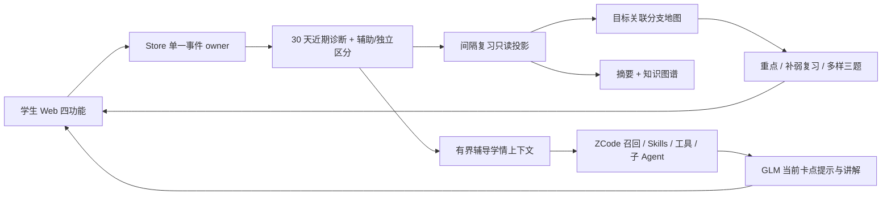

# 学情证据、分层帮助与间隔复习

2026-11-20。继续基于 ZCode；不接入 deepseek-harness。不增加学生入口，仍为辅导、路径地图、看板、三题练习。

## 单一状态与证据

Store / SQLite 仍唯一保存实际作答和请求。新学情与复习计划为同一事件快照的只读投影，不创建第二份档案、成绩、定时器或模型掌握记忆。历史累计次数保留；当前判断只使用最近 30 天、最多五次独立首次作答。稳定要求最近一次错误/辅助完成之后至少三道不同新题独立正确，并包含变化难度；一次诊断只确认起点。过期证据回到待诊断，旧答对不能在新错误后的辅助改正时恢复稳定。多标签题仍只是相关知识点的表现证据，不声称逐项诊断。

作答结果新增 unassisted：当前 assignment 首次、无提示及已有辅导的作答。与 independent（该题从未做过、非导入历史题、无已有帮助）分开；无辅助的到期复做可以检验保持，但不提高独立首次正确率。旧记录缺字段时保守沿用 independent，不推断历史复做是独立。

## 复习调度

采用可解释的启发式间隔 1 / 3 / 7 / 14 / 30 天，不宣称已训练 HLR/BKT 或校准保持概率。一次新题正确安排次日确认，多题新题稳定后起始间隔为三天；真正到期且无辅助的正确作答才延长一个间隔。同日刷题、换组、读看板不延长保持间隔。答错重回基础，并安排短间隔；辅助完成不延后已经到期的复测。历史“可进阶”只提出历史复习建议，不是保持确认。

每个 profile.review 提供 status/due_at/interval_days/passed_checks/source/reason。review_overview 分开统计本产品到期与历史建议。路径排序、节点检查点、看板摘要/颜色、三题推荐共用此投影；策略版本变化使旧推荐快照失效。目标相关范围、年级、质量与冷却仍优先于凑满三题。题不足如实说明。

## 辅导与 ZCode

教学 owner 从同一学情快照选取有界 learner_context，进入原 compose 字节预算与检查点；模型只读，不能改身份、成绩或路线。所属题只取其服务端绑定知识点；自由题/图片不猜测映射，只提供当前学习概况并注明未匹配。GLM 普通题、图片辅导接收同一 context；路由与专项工具继续由既有 ZCode ToolRegistry/Executor/Scheduler、Skills、MCP、子 Agent 与召回适配执行。

同题已经提示且学生仍说不会时转为解释当前卡点/相似小例子，不重复同一句追问；自动升级帮助不自动授权公布最终答案。学生明确指定提示方式优先；同题“不要答案”延续到明确请求答案，新题、过期和其他学生不继承。当前题绑定与支持题型核验继续先于生成。新增上下文/教学协议版本参与恢复签名，旧在途请求不能静默换策略重发。

## 验收

先维护隔离 HTTP/SQLite 验收：旧成绩过期、错误后辅助不恢复稳定、三题变化难度稳定、同日不延后复习、到期正确递进、提示/重试不延长、复做不提高首次统计、历史来源、读接口不写入、原编号幂等、学生隔离、路径/推题/摘要同快照；教学模型协议夹具验证上下文确实进入普通题/图片请求与预算、同题帮助升级和新题不继承。浏览器验证摘要/图谱的复习状态、单地图和三题、浅深色/手机。保留既有图片三图与历史题回归；模型夹具不当作真实教学效果。根类型/Lint、教育构建/Hooks、架构均实跑。
