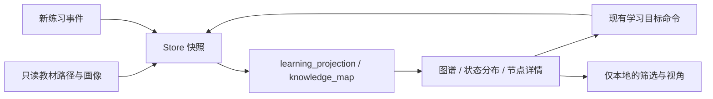

# 学情图谱看板

看板首屏呈现可交互数学学情图谱与历史画像状态分布，不能用全零的新练习指标覆盖导入历史。现有初始化有 71 个源知识点，仅 53 个匹配教材图谱；其余 18 个也展示画像，详情说明教材关系待补充，不能补造先修边。没有画像和新作答的知识点保持“尚无证据”。

Store 仍是唯一学生状态 owner。learning_projection 同一快照增加 knowledge_map：按教材知识路径/画像路径分类的节点、来源画像、自动练习可用性、已存在的先修候选边。节点不含标准答案、源学生标识、会话原文或同学排名。Catalogue 只读补充节点路径；knowledge_map 为纯派生投影，不创建持久化缓存。边只来自已有 requires，分区连接为视图分类，不代表先修关系。

默认“综合学情”：有本产品作答时显示近期练习表现，否则显示初始化画像；分别可切换“历史画像”“近期练习”。源 mastery 显示为“掌握估计”，近期 accuracy 显示为“独立首次正确率”，不合并成未经校准的掌握评分。历史状态采用源待诊断/待巩固/可进阶；新练习采用现有状态规则。日期、画像来源和示例身份说明保留。

学情摘要位于看板开头，先简述学习现状、相对熟悉的知识点与可执行的下一步，并用紧凑状态标签代替独立统计卡。摘要直接依据完整 LearningOverview 同一快照生成，不请求模型，不持久化第二份总结或学生状态；新作答后随投影更新，图谱搜索、分区与来源筛选不改变全局摘要。相对熟悉只选已处于可进阶状态的节点，近期与历史的不同指标不混合排名；优先建议有同年级可核验题的待巩固/待诊断节点。无画像或作答时不编造强项，提示先做诊断。有新练习时显示其实际作答次数与独立首次正确率，辅助/重做不写成独立掌握。

移除“初始化学情”“本产品新练习”两块独立卡片，也不再突出历史作答次数卡片。摘要标注历史画像、近期练习或综合来源；示例身份、历史日期/作答次数、来源未关联与教材关系待补充等说明折叠到图谱下方的“数据依据”，默认收起。有新练习时其详细计数也保留在这里，不能隐藏来源差异。摘要行动复用原有 goal 命令进入对应练习推荐；未知结果的处理不变。

图谱提供学科分区、知识点搜索、需要关注的节点筛选、缩放/复位、节点点选与键盘访问。全景每分区最多四个代表节点，优先展示需要关注的节点，同时保留可进阶和待诊断的代表，让首屏反映不同学习状态；分区的小色条统计当前来源下的全部节点状态，不能把概览抽样当作全分区统计。清楚标注可展开全部；分区视图展开全部匹配节点。详情同时显示历史掌握估计/作答次数/正确率和新练习次数/独立正确率，解释当前显示来源。先修候选使用虚线且标明未教研确认。未关联教材节点不展示伪造边。

首次默认选中需要关注且有可核验题的代表节点，避免用无题目的节点作为唯一首屏行动入口；同状态下优先可练节点，其余节点仍可展开或搜索查看。点“练这个知识点”通过 LearningPanel 现有 goal 命令提交（未知结果复用原目标，练习提交复用原 request_id），成功读取 learning_overview 后进入练习页，不另建状态写入通道。没有同年级可核验题的节点提供查看学习路径，禁用开练按钮并解释题目待补充。浏览器只保存筛选、选择与视角。

复用 ZCode Button/Input/Select 和主题 token，SVG 只画连接，HTML 按钮呈现可访问节点；浅色/深色以及 390px 手机均能查看图谱与详情，无页面水平溢出。摘要保持紧凑，手机图谱浏览区在首屏内开始展示。详细成绩折叠于数据依据，近七日记录位于图谱下方；近七日仅使用 daily 投影，有练习时区分总作答与答对，没有时不展示独立趋势卡，由摘要提供诊断入口，不填造趋势。不新增导航或教师功能。

验收：71 源画像完整展示（含 18 未匹配节点），分类完整且边端点合法；无画像的隔离 seed 仍能工作；首次进入看板可见图谱与非零历史状态分布；节点详情、搜索、分区、来源切换、弱点筛选、缩放/复位、开练流程；新作答更新近期展示且保留源画像；源数据不写成新练习；移动端/主题/键盘与无运行时错误。必要 Python/HTTP/浏览器回归、类型、Lint/Hooks、构建和架构门禁。

