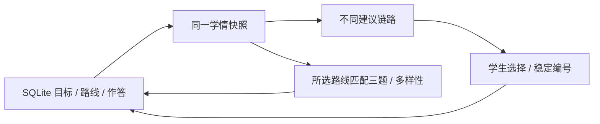

# 学习路线可视化

2026-11-20。学习路径页面仅展示一张分支地图，同时呈现服务端提供的不同链路。学生选择路线后，个性化练习实际按该路线重新匹配三题。设置、节点说明与练习入口嵌入地图，不保留独立详情卡、今日行动卡和调整规则卡。

## 状态与规则

路线生成须使用目标的教材先修候选、知识层级路径及题目多知识点关联，不能只因同属“数与式”大类就把平方根拼到有理数加法目标。先约束目标关联范围，再用近期错误、独立诊断、复习到期和可用新题排序。每一步显示真实关系依据与学习检查点；未经教研确认的关系继续标注候选。

教材中存在但导入题库无题的有理数加减目标，可补充系统基础变式：只使用可精确计算的整数加减、情境题、选择与求缺项模板，标明“系统基础变式（数值规则核验）”，不能冒充导入原题或教研确认内容。生成是确定性的只读题库投影，答案由数值规则计算；原题库和教材文件保持不变。变式同样参与曝光、冷却、独立作答与三题多样性检查。

稳步推进沿目标和相关诊断；补弱优先从与目标关联的基础卡点返回目标；拓展应用沿后继或综合题关联扩展。路线长度依据学习时间控制在三至五个站点，不通过打乱同一批知识点假装多样性。当前路线在地图内部说明整体理由，点选节点说明这一步怎样支撑目标。无相关题供给时如实显示不足，不伪造知识依赖；推荐跨链补充需说明实际关系。

路线是跨日的短程学习地图，时间预算控制展望深度，今日只安排预算内的练习。三至五站是有足够证据时的上限范围，孤立目标或关系不足可少于三站。目标必须保留；补弱链的先修节点按基础到目标的方向排列，不能先练减法再把加法说成下一阶段。每次诊断后，当前重点移到尚未确认或已到复习间隔的节点；确认一次只允许推进诊断，不宣称掌握。节点检查点随状态变化，近期错误先解释或做基础变式，提示后正确需独立确认，稳定节点安排间隔复习。

综合题关联仅统计同年级、题干完整且能核验答案的题目。教材大类相同、跨年级题目共标签均不足以生成拓展路径。每个新节点既须与目标有关，也须与上一节点有依据；不把互相关联但与目标无关的链继续延长。路线去重同时比较知识点集合，不能换顺序冒充不同策略。原题存在但缺少必要图表时，仍视为当前无可用题供给。

图谱中互为先修的循环关系不生成学习顺序，保留目标单站诊断，避免把有冲突的依赖画成正常进阶链。

推荐始终限制在目标关联范围。相关知识点不足三个时，用不同题型、模板补齐三题并显示真实限制，不用无关联知识点填满。完全缺题时保留目标和不足说明，不推荐远处题目冒充目标练习。

补弱优先选择路线内具有基础新题供给的未确认或到期复习站点作为当前重点。不能因为最前面的基础知识点恰有一道进阶综合题，就把这道难题当作基础诊断。只有难题的节点保留教材关系并说明供给限制；不伪造基础题或将未完成节点标为掌握。

- path.routes 提供去重的短程候选链路：稳步推进、补弱优先、拓展应用。题目不足或链路重复时仅提供可用的不同链路，不伪造路线。path.selected_route 表示当前有效选择，path.steps/focus 与之对应。
- POST /api/learning/route(route, request_id) 经 SQLite 事务写入学生隔离的路线偏好及幂等事件。同编号同参数重放不重复写入，冲突拒绝；旧选择重放不能覆盖后来选择。目标更改保留偏好，学情变化时重新派生同一策略的链路。
- 推题指纹包含路线。第一题匹配路线当前重点，后两题优先路线内不同知识点，保留题型、模板与曝光多样性。补弱优先基础难度；拓展改变覆盖方向，难度仍依据学生证据。冷却或缺题时补充相关可用题。
- 连线表示建议顺序，未确认先修不是强制解锁条件。点选节点只查看地图内说明，选择路线才写入偏好。键盘、图标与文字提供等效交互。
- 近期独立首次正确率与历史掌握估计分别命名；无作答时显示待确认，不展示虚构完成进度或奖励。
- 练习、路线和目标复用 LearningPanel.execute，未知结果保留原操作。切换路线不删除当前练习，不写成绩。
- 桌面横向分支；手机同一地图向下分支。时间、目标设置、缺题说明在地图内；主题、字号和减少动效偏好沿用 ZCode。

## 验收

HTTP 与浏览器逐项验证：单张地图、多条去重链路、选择影响实际三题、刷新恢复、幂等和冲突、旧重放不覆盖新选择、学生隔离、缺题、目标改变和错误后动态匹配、多样性、开始练习、手机和两主题。保留原四功能与完整 Python 回归，执行类型、Lint/Hooks、架构与构建门禁。
