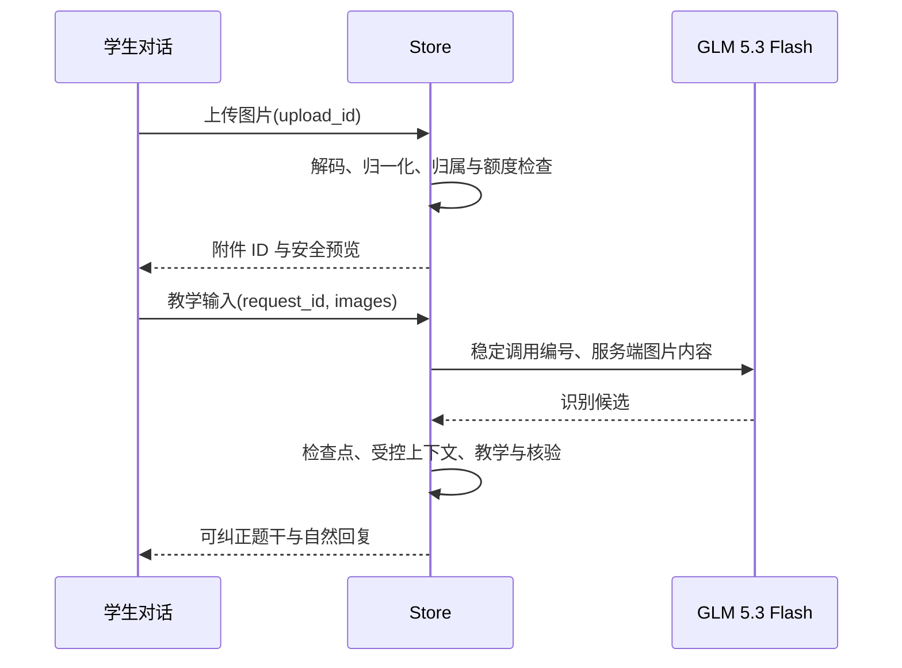

# 图片与历史题自然辅导

## 2026-11-21 识图协议修复

实际 run 54 的“解这道题”已上传附件；Flash识图返回顶层 input / required_output_schema，被识别结果schema拒绝，却错误返回400 invalid_input及内部字段名。识图生成使用专门的系统schema放置方式：系统消息明确输出字段和schema，用户消息仅传 input 中本轮请求和实际图片，不再把输出schema混入图片内容。模型原生json_object约束保留；通用主控和worker既有协议不改变。

识图结果仍严格核验text/unclear/note，只兼容已有unclear_reason别名，不把模型回显或schema当成题目。已收到完整响应但JSON/识别字段错误，记录model_output_error并返回502 model_protocol与学生可读说明；前端按现有规则解除pending，保留原文字、图片和已上传ID。旧版本同类失败再次打开/继续时也返回停止的模型格式错误，不按原编号再次付费调用，不覆盖失败证据。

验收须覆盖实际照片上传→识图→教学的真实Flash调用、回显错误/缺字段/错误类型、同编号停止和重发新编号复用附件、正常识图缓存、原多图浏览器和模型载荷。模型格式错误与无效用户图片、跨学生附件、网络未知结果分别处理。

真实三图复测发现“按顺序描述图片，不解题”中的否定解题被当作肯定解题，描述任务落入短提示预算。图片描述意图仅将未被否定的解题/答案词作为冲突；描述回合直接说明可见信息，不追问，零追问仅用于本轮且不写成长久偏好。展示保留“图片内容解读”标签。

兼容提供方在有效text/unclear/note结果旁夹带input和required_output_schema包装元数据：仅当实际识别字段完整且无其他未知字段时删除这两个已知元数据，然后照常严格验证识别字段。仅回显包装、字段类型错误、未知额外字段仍拒绝；不从input中提取或猜造题干，不使用模型返回的schema改变验证规则。

历史题复习必须从服务端所属练习绑定完整题干，不依赖“提示/引导”等固定词命中；“返回原练习，我想复习这道历史题，请先和我讨论解题思路”必须直接开始该题的教学。取消、新题、跨会话和跨学生仍不能借用旧题。支持题型的步骤核验优先；通用题干辅导复用可信 GLM 文本网关和同会话历史，模型无权写成绩。连续短回复必须接着当前题解释，不能循环要求重新提供原题。

题干、用户消息和助手消息中的 $★$、$■$ 等掩盖符号统一通过教育数学显示适配层映射为对应 LaTeX 符号，原题库与消息内容不改写；代码块和普通文本美元符号不受影响。保留 ZCode 主题与代码高亮。验收必须检查助手气泡内的独立符号，并覆盖实际截图题、选择历史题→发送→具体原题提示→多轮回复，以及多类真实题库，而非仅检查历史题选择成功。

每次支持 1–3 张图片一起发送。读取完成前禁用发送；上传编号与附件 ID 沿用既有协议。实际教学请求等待中，原文字及全部图片进入同一临时用户气泡；成功后由 Message.images 接管，输入框清理本次草稿。失败保留原草稿。恢复已有消息不重复显示临时气泡。

草稿与消息缩略图使用完整图片适配，不按中心裁切，避免题干位于纸面边缘时预览看起来为空白。完整预览验收等待实际图片加载和弹窗动画结束，关闭后再保存消息截图。

发送前、等待中及历史气泡直接使用 ZCode Attachments / Attachment / AttachmentPreview；消息图片支持键盘和鼠标打开完整图片。所有图片按选择顺序参与同一次识别和辅导，并保留到历史。验收覆盖三图、分批追加、移除、四图拒绝、等待中气泡、接受后清理、刷新历史、模型多图载荷、失败恢复与真实 GLM 多图推理；协议夹具与真实推理分列。

学生辅导仍是一个对话输入框。输入区增加“上传图片”和“历史题目”，支持 JPEG/PNG/WebP 题目图片、预览与移除，最多三张。发送时图片先上传到同一学生 Store，返回不透明附件 ID，教学 Request.images 只接受这些 ID。图片按真实格式解码、限制 8 MB 原文件/1600 万像素，转为最大 1600px JPEG 并移除元数据；每位学生图片总量最多 24 MB。SQLite 是图片与学习状态的唯一 owner，重放上传编号不能重复存储。读取图片也鉴权，不允许外部 URL、文件路径、SVG、跨学生附件或未经接受的模型参数。

多模态角色为 vision，模型默认 glm-5.3-flash，端点沿用可信 BigModel API 与环境变量凭据。使用标准 chat/completions 的 content[text,image_url] 协议，数据 URI 仅由服务端从所属附件构造。模型配置未启用、鉴权失败、模型不支持视觉或结果未知时如实报错，不伪造图片理解。当前线上模型名称与视觉能力须实际调用确认，配置成功不代表调用成功。

真实提供方曾在识别 JSON 中附加 unclear_reason；只允许将这个已知说明字段归一到 note，text/unclear 保持严格验证，其他未知字段仍拒绝。这不是再次模型生成，不对未知结果自动重发。

图片描述/辅导回复改用自然文本输出，沿用同一模型网关、学生所属图像内容、账本和调用编号。OCR 仍使用受控 JSON；未核验图片的教学回复不再要求模型生成内部工具动作 JSON，动作标签由教育服务依据请求目标和教学策略生成。明确要求描述、分析图片内容时直接解释；解题提示仍不提前给最终答案，精确核验规则继续优先。可继续围绕同会话图片询问，不把旧题库原题混进新图片。文本生成包含同会话最近自然消息和回复，以维持多轮对话。

直接复用 ZCode createChatComposerAttachment / serializeChatComposerAttachment / revokeChatComposerAttachment 的读取、序列化和 object URL 生命周期，使用公开附件预览、移除组件。教育层限制三张/8 MB，附件引用仍由教育 Store 颁发，不迁入桌面路径或另一套会话存储。

模型回复协议耗尽必须返回 model_protocol 和明确的模型错误，不能映射成账户权限 403。此类已知失败保留原记录和草稿，允许用户编辑后作为新问题发送；不自动重发旧编号。旧版本已耗尽 JSON 修复预算的图片请求同样标记停止，恢复不再触发模型。模型未知结果继续遵守原防重发规则。

图片识别是同一已接受教学 run 内稳定编号的模型调用：图片→受控识别 JSON→检查点→教育意图/教学策略→辅导。识别题干显示在对话中，可自然纠正；模糊/缺条件先追问，识别文本不是系统指令，不能给模型扩权。此会话可继续围绕图片追问，取消/新任务/TTL 后解除旧图片绑定。GLM 5.3 Flash 负责图片与未核验视觉问题的自然辅导；已支持线性题仍由服务端精确检查，其他题型不宣称完整步骤已核验，也不把图片对话计入题库成绩。所有模型调用沿用已有账本、超时与未知结果防重发；恢复读取已完成识别结果，不重新 OCR。

历史题选择器只读显示本学生实际作答题及可映射的导入历史题，区分来源、搜索题干/知识点。当前产品作答复用原练习会话；导入题通过既有 start 创建复习会话。历史练习不伪装成独立首次诊断，残缺原题只读并标明不可继续核验。选择器不包含答案，选择后原题放到对话参照，不把完整题干复制进用户气泡。

提交中的临时用户气泡只显示实际 pending 请求，不能把新建会话或提交完成后的侧栏刷新显示为学生说过的话。响应已接受后移除临时气泡；其他忙碌阶段只显示更新状态。浏览器验收等待实际输入框恢复可用，再保存最终对话截图。

验收：真实 HTTP 上传/图片鉴权/格式/像素与大小/编号幂等/跨学生拒绝，受控视觉 API 检查真实 image_url 载荷/识别/后续图片绑定/自由线性验证/模糊追问/已完成 OCR 恢复/未知结果不重发，历史题来源与搜索/选择/复习独立性，浏览器实际选择图片、预览移除发送、识别显示、手机浅深色及原四功能回归。真实 BigModel 结果单列，协议夹具不算模型效果。

