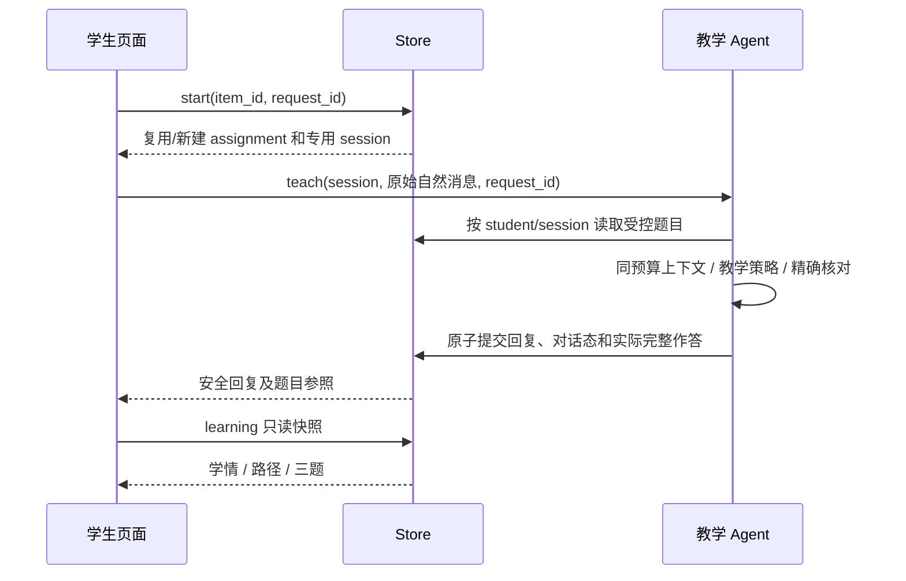

# 四功能实用性与交互审查

学生 Web 仍只有个性化辅导、学习路径、学情看板、个性化练习。优先修复题目与辅导上下文脱节、同题重复创建、部分步骤被当成整题、路径与图谱焦点不一致，再改善视觉层级。复用 ZCode 公共消息/数学渲染、主题、按钮、调度、Skills 与记忆，教育验证仍由 Store 唯一 owner 管理。

练习专用会话从 Store 按 student/session 读取绑定题及版本，学生不传 assignment/答案/身份来构造辅导上下文。完整代数/选择题已绑定时不能再要求重复提交题目。源题、选项和教学提示作为内容进入同一预算内；标准答案只留在服务端核对，模型提示模式不获得参考答案。按原规则处理取消、新任务、同会话 TTL 和请求重放，其他会话不借用题目。

自然对话可以讨论已绑定题、回复选项/数值/最终变量结果，或提交支持的一元一次方程中间步骤。已核验中间步骤只确认该步，不计作完成。只有完整最终作答通过 Catalogue 统一判据后，才在现有 Store.commit 的同一事务写入 practice_events；原编号重放不重复计分，提示/辅导后完成仍为辅助练习。自由输入的一元一次方程使用精确线性判据，不能据此创建题库成绩；其他题型不得伪造核验。

当前方程追问允许自然回复单个数值，明确最终答案可直接核对；中间等式先按当前原方程的解判断是否等价，不能将错误变形作为另一道新题重建参照。明确解新方程仍可切换任务。取消后的脱离标记跨后续命令和 TTL 保留；专用题 TTL 后阶段归零，明确“返回原练习”才恢复主动绑定。

离线辅导对实际题目提供分层提示，已确认的一元一次方程/相反数/平方根结构使用可重复的具体引导；不能只轮换“已知与所求是什么”模板。真实模型可基于受控题目上下文组织概念追问，但确认和最终结果必须服从服务端核验与泄答规则。工程验收不代表真实模型教学效果。

重复点开同一未完成题复用现有 assignment/session，新增请求编号保存幂等别名；完成且在冷却期内也回放原练习，不能通过重新开始抹掉提示与历史。旧会话不删除。历史标题从绑定题目派生短摘要，侧栏默认只显示少量最近对话，支持搜索及展开全部；这些是只读视图，不是第二份会话事实。

题干质量准入同时检查缺图/缺表、未配对数学分隔符、残缺的纯代数公式（如 `$4x-$`）。不试图借参考答案补齐原题。残缺题退出新练习和推荐，旧绑定只读保留，并以 item.usable=false 与 quality_note 说明，禁止继续给该题计分或生成针对性引导。策略版本变化使原推荐批次失效。绑定核验先检查题库版本；取消、换题命令仍可退出无效绑定。不同完整“和谐方程”标题附主方程摘要，残缺题明确标注不完整。

辅导页面只保留简单对话和固定的题目参照，点击“和导师一起做”不再把整段题干重复塞进用户气泡。用户消息使用共享安全 Markdown/数学渲染。路径先显示今日重点和可执行行动，目标调整收进折叠区；只推荐当前年级有题的目标，已有缺题目标仍保留并说明。图谱默认选择同一 path.focus。推荐三题突出用途、知识点和依据；做完后给出明确的下一步。视觉使用共享字体与语义色，桌面/手机及浅深色均可用，不新增技术页面或虚假学习奖励。

验收：截图中的代数题可直接引导、启发不泄最终答案、中间正确不计整题、最终答案回流且辅助标记正确、选择题辅导与自由线性题、同题开始别名幂等/不新增会话、历史搜索/展开、消息公式渲染、四页面主行动、完成后下一题、目标折叠与图谱焦点一致、手机与主题、原有恢复/隔离/三题回归及工程门禁。

