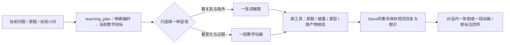

# 一次教学择一展示图或动画

2026-11-25，用户将视觉策略改为一次教学最多输出一个图示。本文替代contextual-teaching-visual-pair-v1中的默认配对规则；原教学模式、同题恢复、小问权限、流式与标注规则继续生效。

teaching_plan是本轮视觉选择的唯一决策来源。当前明确要求静态图、动画或纯文字优先；未指定时，结构、位置、条件、比较和概念理解优先静态图，旋转、平移、运动、变量变化、逐线绘制和有可信步骤的推导优先动画。无法构造有意义的动画时不凑数或冒充动画。明确同时提及图和动画仍由当前教学目标择一。

符号Controller最多提供两个受控内部候选，Agent在执行前选择当前小问最相关的一个。原render_teaching_visual的模型和执行Schema都只接受一个图示，工具输出和新回复最多一个产物。数学绑定、真实类型、原题参数和答案许可继续逐项核验；静态和动画是同一可信构造的两种投影，不能因换呈现类型误拒绝合法构造。

视觉决策保存delivery与reason，随原teaching_plan进入运行记录；不增加独立的记忆表或第二套UI状态。旧历史和相同request_id重放保留原产物，不删历史，也不在浏览器静默改写旧消息。

未明确要求动画且当前没有可信动态构造时，计划更新为静态解释并记录选择理由；不能让计划写“动画”而实际展示静态图。明确动画请求仍要求真实动画产物。

减少重复编译、输出数据、渲染及后续模型输入中的图示内容。原图与动画经常由同一次工具调用生成，不能声称择一一定少一次模型调用或token减半。首段和完成延迟、模型调用数及实际usage分别记录；识图、远端模型推理与修复调用仍可能是主要延迟来源。

验收覆盖：默认关系解释只给图；明确旋转动画只给动画且能连续播放到底；默认过程请求自动选择动画；同题刷新保留教法与已选产物；多问混合请求最多一份并绑定当前问；函数/非负式的一个图示内部可以包含多个必要子图；纯文字不造图；新回复无“图和动画都已生成”的错误回执；多SVG标注和图片回传仍可用。运行时、浏览器、工程门禁和正式只读检查分开报告。
