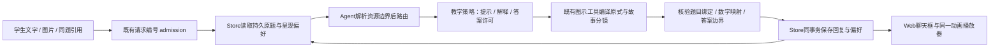

# 教学形式切换保留同题资源

2026-11-23。截图中“你不能创建情景故事来教学吗”及“题目就是上一个题目”连续澄清。生产记录中原题assignment仍存在，但被路由的new_task结果错误置为practice_detached，随后澄清轮又截断有效同题历史。

## 状态规则

原题归属由Store拥有，任务路由不拥有题目寿命。换讲法、故事、场景、图表、动画、批评上次回答和短追问保留当前资源；只有明确取消/换题、有效的新题资源或独立新计算才解绑。澄清回复不能因为“路由未知”清空或暂停原题、答案限制和教学偏好。

同会话有效的owned assignment可恢复旧版误解绑；不能跨会话、跨学生或穿过明确取消/新题边界。旧澄清在读取同题历史时跳过，保留前面的真实用户请求与导师回复。明确“上一个题目、上一道题、题目没换”恢复同题并继续未完成的教学形式，不反复要求重新贴题。没有可绑定资源的会话给出一次具体说明，不借用其他会话。

WebStore.detail的原题栏读取Store.current_problem恢复后的资源归属；旧practice_detached错误标志不能单独隐藏仍有效的原题。该修复是只读投影，不改写旧回复；明确取消或接受的新题仍不展示旧assignment。

## 教学呈现

故事是呈现形式，与提示/讲解/答案许可正交。故事要求应先给故事和数学映射，不只换标签或复制原动画。原题条件、变量和x的范围不因类比改变；教师提供的条件不是学生已掌握的事实。

恒等式复用identity_probe模板增加scorekeepers场景：两台积分记录器接受相同输入x，按原式设置每单位调整和起始偏移。0/1/2输入对应原式账单，接着比较固定部分与变化部分。积分与输入可以为负或分数，不额外限制x；提示模式仍保留最终乘方。用户要故事并明确不要动画时只给自然文字。

呈现形式由Agent从当前用户要求和同题请求继承，已接受偏好由Store同事务保存；只有同一资源、未取消且未明确改形式才继承。旧版误澄清可从同题用户请求恢复故事要求；不能从导师话语推断用户已经理解。

明确故事请求默认可附场景动画；明确拒绝动画时为文字。已接受故事后的普通引用以文字续讲，避免反复附加相同动画；本轮再次要求动画才生成新图。generic题型通过原导师收到presentation要求，不伪装为受控恒等式模板。视觉协议v5新增可选scenario，历史v4普通恒等式动画仍可展示。

真实GLM验收发现遮数方程组2x+y=16被解释为“两个人都翻倍”的反例。已支持的遮数方程组由纯呈现编译器从linear系数生成角色、每种记账规则和已知输入，不让模型改写数学映射。沿用原PracticeTutorController调用，GLM只生成不带数字、公式和运算关系的短开场；越界开场被拒绝并使用固定开场，回复仍附当前题的受控数学规则，不隐瞒质量拒绝。最终答案仅在原教学策略授权时附上，模型输出不生成掌握事实。

短开场是可选润色：模型传输/格式失败时记录failure_type并使用受控默认开场，不重复未知调用、不令已可确定生成的教学故事失败。身份/权限拒绝仍立即拒绝，不用默认开场绕过。

## 验收

先复现动画→情景故事→“上一个题目”完整链路。覆盖首条故事、旧误解绑及TTL恢复、无关键词短追问、故事/文字/动画切换、取消与真换题、学生/会话隔离、同编号重放、故事数学映射、不计成绩和答案限制。浏览器测试原题栏始终存在、故事账本确实变化、播放/单步/刷新/手机、无重复澄清。执行已有图示和提示回归、类型检查、Lint/Hooks、构建和架构门禁，更新两个Web入口，不清空生产历史。
