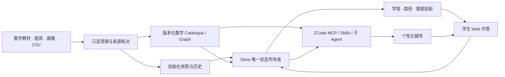

# 数学学生数据接入

Python owner 将受控 graph_path 通过 Runtime init 契约传给 ZCode 适配器；运行时校验路径位于 education/service/data，MCP 子进程只打开该索引。没有指定路径的旧隔离调用保留 curriculum.sqlite。不得由题干或 UI 请求指定文件路径。验收直接通过实际 Registry/Executor/MCP 读取导入的 kp ID。

去重清理包含题号、空答案括号与中文句读差异，保留小数点和条件。低置信标注整组没有成功记录时退出自动推荐；年级冲突也隔离。主知识标签优先匹配题干实际出现的知识名称，推荐按主标签，关联标签仅保留来源。当前教材目录中 16 本没有 relationFiles，不补造其先修边。

产品只提供个性化辅导、学习路径、学情看板、个性化练习。读取用户指定本机数据，原图谱、题库、画像、CSV 均只读。派生索引和身份配置写入 Git 忽略的 education/service/data 与 runs。

数学教材按 manifest.book.subject ∈ {数学、小学数学、初中数学、高中数学} 选择。保留书内目录 ID 与全局 XKW KnowledgeItem/TestingPoint 类型命名空间；同一 XKW ID 跨书复用。contains 支撑目录导航；concept/apply/step 作为未教研确认的先修候选，co_occurs 不成为先修。悬空边跳过并统计。Agent/MCP 与 Web 使用同一数学 Graph 契约。

题库 success.jsonl 按清理后的题干、选项、图片指纹去重，保留全部来源 qid 别名；答案归一化后仍冲突的整组隔离，不能多数投票。缺答案、依赖缺失图片、复杂解答等不能精确核验的题保留为待完善。仅关联数学图谱知识点、同年级且支持选择或纯数值/多空答案的题参与自动推荐。题型标注不可靠，核验能力由内容决定。学生投影不包含标准答案。HTML 只转安全文本，公式使用共享 Markdown 渲染；不执行源文本或下载任意 URL。解法仅在学生提交后请求讲解时展示，来源标注表示自动标注，不能称教研审核。

选数学画像中记录最多的一位（七年级、89 条历史作答）初始化。CSV 用户标识与画像没有对应关系，选数学会话最多的一位组合为明确标注的示例学生；两份源身份不当作同一个真实人。源 IDs 仅保存于本机私密导入清单，不输出报告/日志。CSV 输出列按数字索引排序，排除明确其他学科；历史对话保存为带 imported 标记的 episodes，不伪造 runs/model trace。助手回复不能成为掌握事实。

Store 是学生目标、初始化快照、历史 episodes 与新 practice_events 唯一 SQLite owner。不可变 catalogue 是只读端口，无第二份动态学情。流程：只读导入 → 原子发布版本目录/registry → Store 按 dataset+student 幂等初始化 → learning_projection 从初始化与新作答派生四功能。初始化只插入一次，不覆盖已有新作答/目标。换数据版本有既有练习时拒绝，防止同一题漂移。无 registry 的隔离测试保留 numeric_seed_v1。

初始化 mastery/confidence 是源估计，显示来源和日期；89 是原画像 n_attempts，不能将知识点累计计数相加充当总作答。班级/年级排名只有 3 人，不展示。新练习统计始终从 0 开始，与初始化历史分开；初始化弱点参与路径/推题，不把它们当作本产品独立首次成功。先修候选只作为建议，不自动宣称掌握或永久阻挡学生。路径有环检测与深度/数量边界。

默认实际工作台 registry 只提供 edu-math-student；页面无教师入口或身份切换。既有隔离验收继续用原 DEMO 配置。辅导沿用 ZCode 工具/Skills/子 Agent/记忆边界，初始化画像作为低信任记忆，练习复杂题不送入纯算式核对器。

验收：真实源数量/数学过滤/ID覆盖；去重及冲突隔离；支持题的精确核验与无答案泄漏；一次导入/重复启动幂等；初始化与新成绩分离；学生隔离；七年级路径推题与候选来源；历史不产生新作答；浏览器四导航/选择题/公式/看板/刷新；原四功能及辅导回归；typecheck、lint、Hooks、build、架构门禁。

