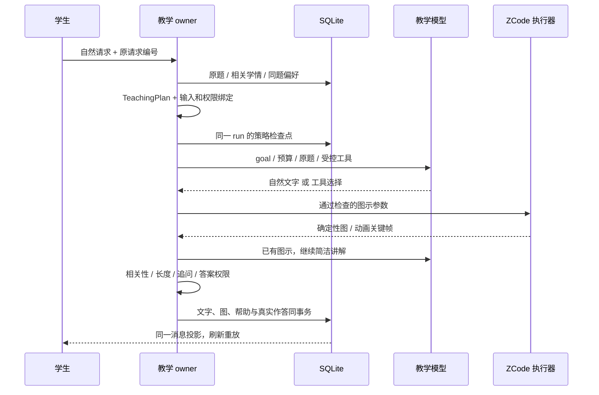

# 学生辅导策略、输出预算与情景动画

2026-11-21。落实 personalized-tutoring-business-plan.md。学生仍使用自然对话、图片、历史题；原有四导航。教学策略不增加表单。

## 事实与决策

Python Agent / SQLite 是唯一 owner。所属题由已鉴权的 assignment 读取；正常教学对话不依赖重说“这道题”。明确新题、取消、其他任务与闲聊不绑定旧题。概念问题即使没有练习也可直接解释。对话摘要 TTL 不清除同题的答案偏好；取消/换题清除偏好，跨学生/会话不能继承。

区分本轮 goal（概念理解、某步解释、切入线索、核对、解答）与教学 mode。当前明确要求优先，再按本轮卡点、相关学情和难度决定支持。概念困惑先解释，结尾最多一个追问；“不要反问”保留零追问；直接答案与确认学生作答分开。真实相关近期记录和带来源的初始估计分开，数据不足标为未知。

TeachingPlan 存在同一 run 检查点，包含版本、goal、难度来源、支持依据、答案权限、中文长度预算、追问上限与图示建议。题库等级优先；未知难度使用有来源的概念/结构估计，不冒充训练分类器。Socratic 60–140、heuristic 100–220、explain 180–360、answer 120–300、check 80–180 为初始预算；简单事实不补字数，弱证据/综合任务/详细或简短要求调整预算。模型文字不硬截断公式；完整已知回复不合预算/不相关时按既有最多两次明确新编号修复，未知结果不重发。

## 可视化

render_teaching_visual 仍是同一个 ZCode 只读工具。新增 animation_scene：absolute_distance、square_root、nonnegative_sum、number_line_motion、travel_motion。输入只有模板和有界参数；工具计算数值关键帧、范围和稳定 ID，模型不得提供执行代码或关键帧。8–20 秒播放规范随回复保存；Web 的播放/暂停/重播/逐步/进度为局部展示，减少动画模式默认逐步。播放不发模型、不产生成绩。

SVG 下方显示随同一进度更新的 HTML 数值说明，使用 ZCode text-ui 字体令牌，避免手机缩小图形后数值不可读。说明与图形复用同一个插值计算，近似值保留近似号；连续播放不逐帧播报给屏幕阅读器。关键帧、重置与进度末尾的数值需浏览器验收。

提示模式区分原题和相似例子；不显示原题完整运动解答或受保护结果，既有答案/数值/标签校验继续执行。一般情景/文字不宣称完整证明已核验。表格/柱图/Mermaid/消息/Dialog 直接复用 ZCode；动画播放器是教育的可信 SVG 适配。

## 学习证据

辅导帮助必须是已完成、相关原题的实质教学回复。闲聊、通用澄清和未返回结果的请求不算提示；看过答案后正确作答不算独立掌握。确认正确的真实作答使用原 grader 与同一事务，动画/自报理解不写掌握。看板、路径和三题推荐继续读同一个证据快照。

两个 loopback Web 入口的 HTTP 登录 cookie 按端口分开，避免浏览器访问另一个入口后覆盖当前凭据与 CSRF；业务身份和 SQLite owner 不变。图示完成后由同一 owner 收紧正文预算，语义入参错误进入有界修复，不误报为账户权限错误。

明确独立数值计算（如“直接给 √9 的结果”或“2+3*4”）且没有原题引用时，解除原练习上下文；局部变形、裸选项、明确“这一步”仍绑定原题。Detail.practice 读取同一持久任务态，取消/换题后隐藏旧题，明确返回原练习后恢复。已知模型协议修复耗尽统一返回 model_protocol / HTTP 502，不能冒充账户 403。图示后的正文目标收紧至简短解释，但保留原难度预算的有界余量，不能因少量 Markdown 字符拒绝完整教学。

无整题的概念对话也需支持“那负数呢”“再举一个例子”。只在当前同一会话、未过期且最近成功回复为概念辅导时承接，使用最多五轮连续概念对话；取消、新会话和其他任务之后不借用。连续概念历史是只读模型上下文，不能重建练习题或计分。

## 验收先行

隔离 HTTP / SQLite / 实际 ZCode 模型协议覆盖截图原句（包括已完成题/摘要过期）、未绑定概念、感谢加教学复合句、换题/取消、明确模式/零追问、强弱未知学情预算、过长回复有界修复、直接答案后非独立、闲聊不影响独立、五类动画数值与非法输入、原编号图示重放、播放不计分。浏览器覆盖概念回复、动画播放/暂停/进度/重置/减少动画/手机深色/放大/刷新/四导航。真实 GLM 另做语义审查，不把协议夹具当教学效果。运行相关回归、根 typecheck/lint、教育构建、Hooks 和架构。
