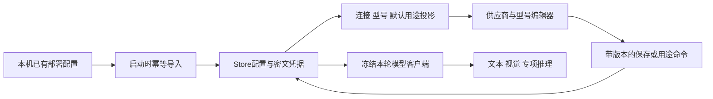

# 统一模型配置

模型适配只保留供应商、连接和嵌套型号编辑器。移除独立的“教学模型”、两个角色下拉框及“应用教学模型/恢复部署模型”按钮。每个已保存型号在自己的卡片中显示默认用途并直接设置文本、图片或当前已配置专项用途，所有选择沿原model-selection命令保存。

Store是配置、版本、密文凭据和用途的唯一所有者。Deployment在服务启动时通过同一个ModelSettings执行幂等导入：保留部署连接ID、型号、能力、预算、推理参数和启停状态，保留旧自定义连接及默认选择。文本、视觉和已配置8B/27B模型都进入同一目录；凭据在服务器本机加密，不经浏览器传输。已导入连接可编辑，不能再被部署文件在读取或重启时覆盖，已删除项也不能重新注入。后续新增部署角色可以追加导入。

默认用途是服务端接受状态，不在UI维护第二份待应用选择。用途命令只修改当前指定角色，按版本/编号准入；文本与图片可使用同一多模态型号。图片用途必须有图片输入能力，失效型号不能被新选择。可选专项用途可取消。修改连接仍保护正在使用的必需型号；已经冻结的在途轮次及现有会话手动选模不被默认用途改写，新轮次读取最新配置。

兼容旧的批量选择协议和模型ID，角色选择不产生学生成绩。UI读取、保存、刷新和未知结果重试继续使用现有EducationService及版本保护。当前服务的配置在部署后验证导入一致，正式教学历史和画像不变。

验收覆盖旧配置导入、所有已配置角色、加密凭据、重启/重复导入、删除不回填、已保存用户配置优先、单角色修改、图像能力拒绝、预算与推理参数实际传入、冻结轮次/会话选择、型号编辑/测试/默认用途/刷新/手机，以及截图中重复教学区域消失。
