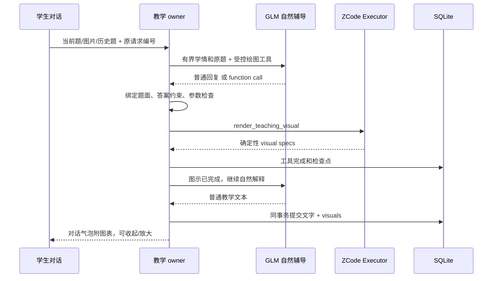

# 对话内可视化辅助教学

2026-11-21。学生仍通过自然对话、图片或历史题进入个性化辅导，教学 Agent 可以选择在助手消息中附加图表。无需另开页面或填写绘图表单；普通解释可以不附图。

## 能力与 ZCode

新增固定只读工具 render_teaching_visual，经现有 ZCode Registry / Executor / Permission / schema / trace 执行。教学 Skill 决定何时适合图示，不增加自治子会话或另一套模型客户端。自然辅导可通过提供方原生 function call 选择工具，工具完成后继续生成普通文本；单轮至多调用一次、至多两张图。已核验简单数学可由本地规则选择图示，无需额外模型。模型未选择时保持原文本协议。

首批支持：数轴与加减移动、坐标点、关系/情景示意、表格、柱状图。表格和柱状图直接使用 ZCode 预置 ArtifactTable / ArtifactChart；关系示意通过 ZCode MessageResponse / Mermaid 展示；数轴与坐标采用教育专用参数化 SVG。复用公共按钮、Dialog、主题、响应式和错误隔离。ZCode 通用 visualize HTML bridge 属于桌面宿主，不迁入学生 Web；本产品不接受模型 HTML/JS、任意 SVG、外链或文件路径。

## 单一 owner 和验证

工具参数只能包含受限数据结构、文本标签和有限数值。服务端校验各类型字段、表格行列、点坐标、边端点、有限数值和算术等式；数轴终点、范围和刻度由工具计算，不接受模型声称的终点。原题数据模式的数字必须来自当前绑定题面的明确数值；例子模式明确标注为示意，不能冒充原题或真实成绩。一般文字/情景语义仍不声明完整数学证明已核验。

图示跟随当前 run、原题/图片上下文和教学策略。不给最终答案时，原题结果不能藏在图表数值/标题/标签中；完整原题运算图应拒绝，改用不同的类比例子或已有条件。工具不能设置身份、调用模型、写成绩。无支持图形则给原文本，明确的非法模型工具结果依现有协议修复/错误规则处理，不伪造图示。

Store / SQLite 唯一提交工具账本、最终 visual specs 与回复；Web 只渲染已接受 response.visuals。工具结果在生成文本前写检查点，刷新、断线、原编号重放读取相同结果，不再次绘图或发模型。新的图示策略参与恢复签名；旧完成消息无 visuals 仍可读，新旧在途能力不能静默互换。

请求“用图帮助理解当前题目”属于当前辅导追问，继承同会话尚未过期的原题/图片绑定；明确换题、取消或无绑定时不借用旧题面。可视化追问与常规提示使用同一原题引用判断。

Python → Node → Python 回调按 JSON 数值语义比较已授权参数；2.0 与 2 等价，布尔值与数字不等价。原身份、字段、路径和其他内容仍须完全一致，不改变既有持久化哈希。小数图示显示已接受数值，不按固定小数位截断。

GLM 5.3 Flash 的图示参数与文字共享有界生成预算；本机配置使用 max_tokens=4096、reasoning_effort=low，仍保留每次 90 秒与整轮 240 秒上限。提供方返回 length 时明确停止，记录 finish_reason、用量和工具数量；不当作可恢复绘图失败，也不静默再生成。

每类图示通过 ZCode 支持的 oneOf Schema 声明自己的必填字段。模型已返回完整、可解析的工具选择后，领域校验错误按已有最多两次修复预算处理；反馈真实字段错误，调用编号含 cursor 与 repair 序号，避免反复读取同一份坏参数。每次修复是明确的新调用，完成结果仍可重放；未知/截断/网络超时不进入修复。普通辅导优先一图，确有对比需要再选两图。

提供方漏掉 kind 时，只在全部已有字段恰好匹配一种完整类型时补齐这个展示类型；不补数字、边、条件、basis 或标题。明确错误的 kind、混合字段、缺失数据仍拒绝或进入有界修复。这是提供方入参适配，不改变学生原请求。

## 验收

先维护真实隔离 HTTP/SQLite 与模型协议夹具：自主不画/选图、五种图示、两图限制、原题数字绑定、提示不泄答、错误算式/边/过大/未知字段拒绝、工具 ZCode trace、无工具重复调用、原编号重放、刷新与跨学生隔离、图片/历史题同链路。浏览器覆盖消息内图、表格/柱图的直接上游渲染、数轴演示、收起/放大、移动深色、刷新、四导航不变。真实 GLM 用合成题另列，不把夹具当教学效果。执行相关回归、构建、根类型/Lint、Hooks 专项和架构门禁。
