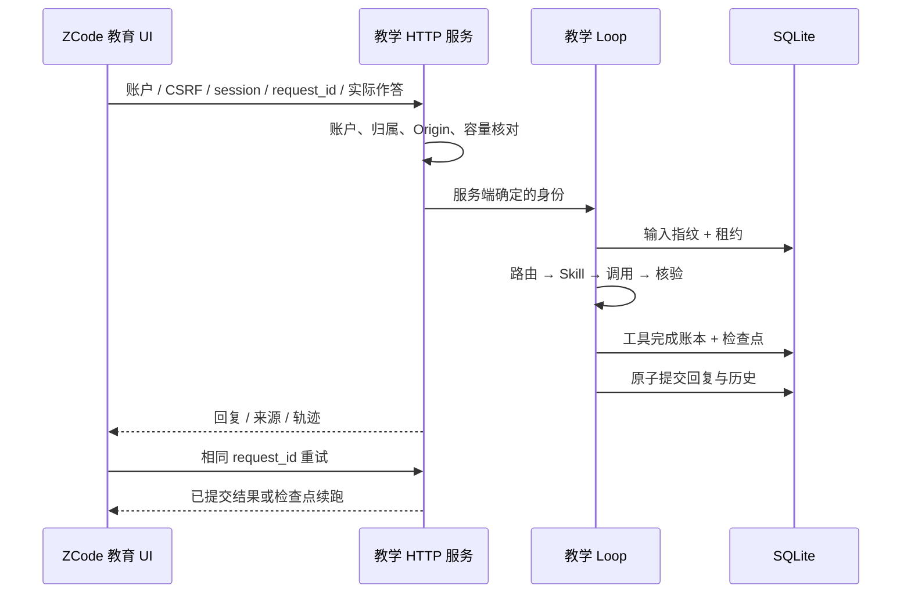

# 清启教育工作台规格

按简历实现路由→调用→核验→回复。GLM 主控可配置调用课程导航 8B、困难分类 8B、审查 27B。当前产品范围以 [四项教育功能规格](four-features.md) 为准，只展示辅导、路径、看板和推题；运行细节保留在后台。

Python 教学服务唯一拥有会话、请求租约、工具账本、学生历史与教师确认事实；UI 仅保留草稿与服务投影。学生身份由账户会话确定；教材、模型与工具正文不能授权 Shell 或访问其他学生。教师事实需教师角色、来源和版本。回复必须引用本轮真实证据；首错定位必须对应原始作答，启发模式不能直接给最终答案。

学生与教师仅通过 Web 使用教育产品。ZCode 的 /education 与独立工作台加载同一组件，不增加桌面、CLI、/learn 或外部 MCP 交互。退役教育插件、插件安装器、旧 token API、旧 HTML/Web server 与教育 CLI；上游通用源码、内部图谱 MCP server、模型和后台运维脚本保留。WebStore 独立为 web_store.py，product.server 是唯一产品 HTTP 入口。原接口的隔离、鉴权、CSRF、恢复与静态资源回归迁移到当前产品契约。学习入口包含辅导、路径、看板和推题；运行轨迹、记忆、模型连接、课程索引与教师事实作为后台支撑，不独立展示。切换身份撤销旧请求投影；网络失败保留原请求 ID。

ZCode Web 在 HTML 模块入口按路径加载教育组件或原工作区，教育入口不预加载整个 Coding 工作区的依赖。移动端切换身份和完成提交后收起附加输入；展开时表单有独立滚动范围。学习历史将原始结构化作答投影为题目与步骤，技术账本仅在后台保留，不在产品页面展开。

对话列表独立滚动，长历史不能覆盖身份控件。公开辅导正文和作答依据使用从1开始的步骤编号；内部 step_refs 保持从0开始。作答来源显示为“你本次提交的作答”，技术引用仍在原结构化记录中保留。

刷新后，未完成消息提供“继续此请求”，使用持久化消息中的原 request_id 和原输入恢复，不能重新生成ID。服务器仍核对身份、输入指纹、租约及相同部署；预算/工具/技能变更或未知模型结果会拒绝静默续跑。

消息的 input 是展示投影，可包含从问题正文提取的算式或同会话已验证的作答；original_input 是服务器保存的原提交内容。恢复必须提交 original_input，不能将展示投影重新作为用户输入。浏览器验收在真实服务中断点后刷新，分别验证正文算式提取与同会话追问，核对提交内容、请求编号和工具调用次数。

“核对/核验课程、教材、章节或图谱关联”按核对对象路由为课程查询；仅凭“核对”不能要求学生补算式。实际作答字段、答案/计算/步骤等明确作答信号仍进入审查，复合请求保留两个意图。

验收：真实 HTTP 与浏览器验证错误/正确作答、课程引用、刷新持久化、学生隔离、教师权限、CSRF、Schema、MCP、输入指纹、租约、中断续跑、窄屏与键盘操作；执行类型、Lint、架构与构建门禁。真实模型教学效果和公网部署另行验收，不将本机演示称为生产效果。

## 真实模型部署契约

GLM-5.3 使用 BigModel OpenAI 兼容 API，reasoning_effort=low，输出 JSON，凭据仅在运行进程环境中。8B/27B 的服务固定监听服务器 loopback，经 SSH 隧道与随机 bearer 凭据接入，不能用学生文本变更 endpoint、权重或设备。专属模型各有并发锁和有界输入，超时后服务仍占有模型锁直到推理结束；不自动重发未知结果。

支持 JSON object 输出约束的主控部署显式启用 json_mode，OpenAI 兼容请求携带 response_format={type:json_object}；其他模型保持原协议。GLM 的回复 Schema 同时约束当前辅导策略允许的 teaching_action，启发模式不允许 explain/give_answer。提示词、提供方 JSON 约束与服务端验证共同执行，不能用松开验证来接受非法回复。该配置参与部署签名；变更后旧检查点不能静默续跑。用实际本机 HTTP 协议夹具验证请求参数和辅导 Schema，再执行真实课程整轮验收。

课程查询在唯一图谱候选下按受控计划执行 course_search、worker_course8b、course_context，已确定的阶段不重复请求 GLM 选工具。课程 8B 保持必经，课程事实来自图谱。完成后用核验的结构化证据构造回复。模型可见工具契约由 ZCode Registry 提供；模型产生的短引用需枚举验证并映射回原证据。课程实质回复必须引用已查询的课程上下文证据。

启用审查/学情专项模型后，主控的可用工具集合中由对应 worker 替代离线同职能工具，避免模型已启用却静默绕开；未启用时保留离线工具。课程建议与图谱查询职责不同，二者同时保留。预算包含同一截止时刻，单个在途请求的超时取模型预算与剩余整轮预算的较小值。

SSH 连接目标和端口由可信本机部署配置固定；启动器不修改用户系统 VPN 配置。SSH 加密通道只连接部署的服务器，不接受学生文本指定的目标。

隐藏启动器使用显式管道，并在同一 SSH 会话读取凭据及承载模型转发，不继承控制台输入。凭据最多等待20秒；远端只读令牌的临时进程等待管道关闭后退出，不写入服务器文件。SSH连接有心跳失效检测；三个已认证模型列表通过后才启动产品 HTTP。连接失败必须退出启动器，不能在界面等待结束后遗留无限等待的取凭据进程。

专项就绪检查只访问启用的 course8b / difficulty8b / review27b，并使用 SSH 读取的专项凭据；glm / vision 使用独立 API 凭据，不进入专项 /models 检查。以本机真实 HTTP 夹具验证两个云角色不会被请求、关闭的专项被跳过、错误专项身份或凭据阻止启动。真实恢复另外核对远端与隧道的三个认证列表，不以重启模型替代请求归因。

课程 8B 原生输出章节/先修名称列表，公开工具返回 suggested_titles 和 candidate_requires_graph_confirmation；它不负责选 node ID，名称不能成为引用事实，课程事实仍来自 course_context 的真实图谱。学情 8B 使用选定旧底座+LoRA，原生四分类只转换为待教师确认候选；输出 memory 和 content 不得覆盖实际历史或直接成为回复。27B 使用原生 step_id 从 1 开始的审查格式，转换为 0 开始的首错；它原生没有逐步核验，逐步 checks 来自独立符号核验。27B 的首错、正确性和精确答案必须与核验一致，否则拒绝结果而不编造步骤。当前仅支持数值等式，其他题型需澄清。

离线每轮预算25秒/租约30秒保持不变；真实部署每轮预算240秒，租约260秒，单模型请求不超过90秒。预算与租约记入检查点，变更后拒绝续跑旧请求。请求独占租约覆盖整轮最大工作时间与单次在途调用，结束后释放。产品 HTTP最长等待360秒。真实验收分别报告主控、专项模型和整轮调用；不能用启用状态代替成功记录。
