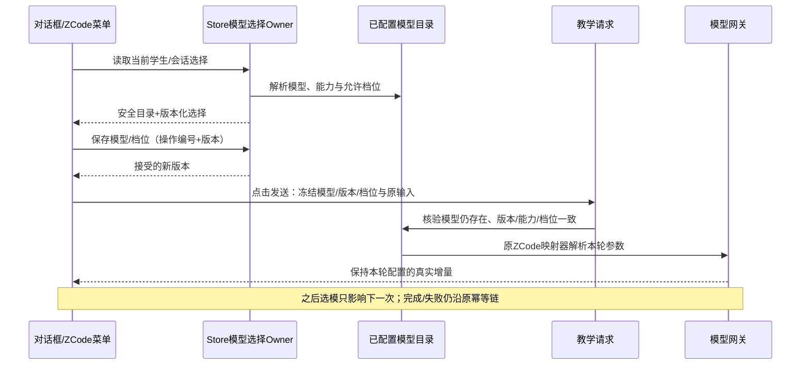

# 对话框选模与推理档位

2026-11-25用户明确：默认高推理档位，并可在对话框选择已配置模型及调整档位。本规范取代上一轮“官方GLM默认low/识图强制low”的默认策略；用户已经选择的low/high/max必须保留，不暗中降档。

直接复用ZCode的ModelConfigSelect（模型与推理菜单）、ModelSelection的能力枚举设计、composerSubmissionConfig的发送瞬间快照，以及model-option-map的受限CEL编译器。只通过新增公开出口适配教育模块，不复制菜单、焦点管理或自行执行JS参数模板。

配置供应商和凭据仍由原ModelSettings/Store拥有。新增聊天选择使用同一model_settings/model_setting_events持久化，按部署入口、学生和会话隔离；未建会话的草稿单独隔离。学生可以读取可用模型目录并选择，但不能通过选模命令修改凭据或接口。目录只返回名称、能力、版本、可用状态及档位，不返回密钥、接口或参数模板。

默认选择当前已配置的文本/视觉模型。支持high的模型默认high；GLM-5.3显示low/high/max且默认high，没有关闭思考选项。其他模型按配置声明的档位展示；不支持档位的模型只保留默认，不伪造high。主动选择新模型初始化到high或已声明的最高档，恢复已存会话时不覆盖明确选过的low。

对话框显示文本、图片两个原ZCode菜单，均可选择已配置模型及本模型档位。选择保存期间锁定发送；当前回复生成中可以为下一次预选，当前请求不被更换。切换不清除文本、上传图片、标注或原题。已删/停用模型或失效档位显示不可用并要求重新选择，不静默换成其他模型。保存命令仅修改明确提交的角色，未修改角色保留；两个模型同时失效也可逐个修复，不能因另一旧角色失效而阻止更换。

请求可携带model_selection，两个角色均含模型身份、供应商版本与reasoning_level。未携带时使用本会话选择，首次默认high。提交已冻结的版本过期时停止并保留输入，不以新配置偷偷发送旧编号。明确重新回答创建新编号并采用当前选择；原编号重连继续使用原快照。隐式创建会话保存当前草稿选择，明确新建会话从高档默认初始化。

所有需要视觉的识图和后续讨论使用同一个视觉角色档位，不再单独强制OCR为low。映射通过原受限CEL编译器，允许受支持的reasoning_effort/thinking参数；不可把任意模板键变成URL、认证、模型名称或消息体。模型选择、输出预算与教学模式是不同设置，改变高/低不授权最终答案。

模型选择仅替换模型客户端。原Flash入口继续使用本地LayeredRouter与OfflineController处理取消、数值核验和规则任务，GeneralTutorController通过Agent.text_model取得文本角色；不能因新增文本菜单引入额外分类请求或把本地控制命令送给模型。完整配置仍保留原GLM主控。两个客户端均纳入原deadline、调用账本、流式观察和使用量管理。首次发送先原子创建会话与冻结选择，再上传图片；会话登记期间只读模型菜单，登记完成后允许预选下一轮。图片上传期间的预选写实际会话，不丢在空会话草稿。

验收：原菜单实际调用、默认high、选low后发送和刷新保持、模型切换/不同会话隔离、文本/图片能力、未知模型/档位/版本拒绝、重复保存幂等、发送前图片读取期间冻结配置、运行时预选不改本轮、标注与历史原题保留、重新回答用新选择、高/低实际HTTP字段和流式连续性。真实高档短对话与可选低档标注用隔离root，正式题库/学习历史保留。
